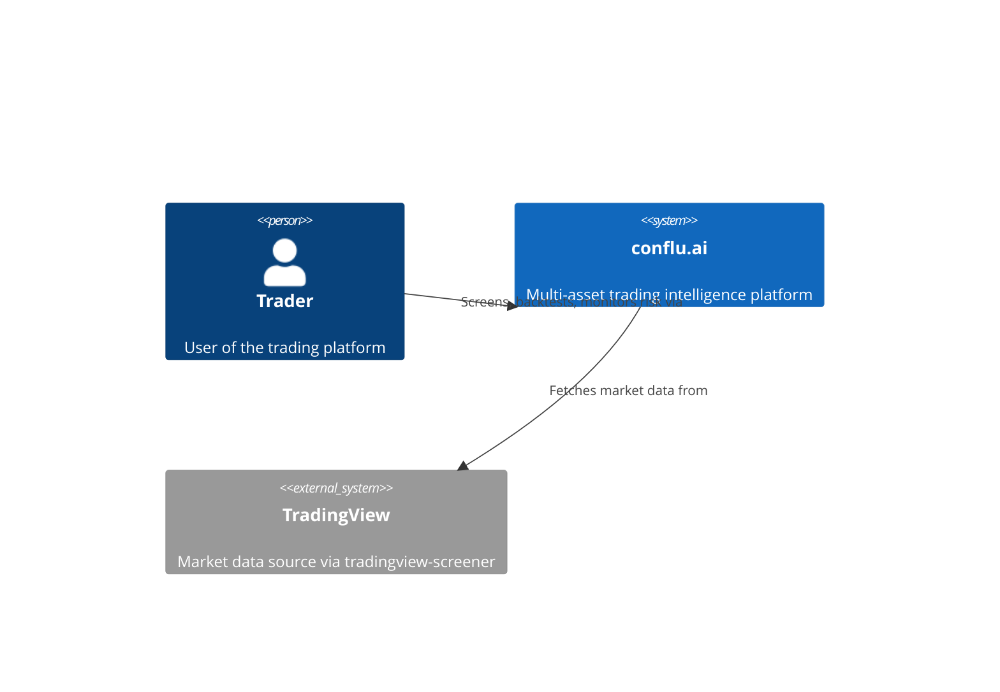
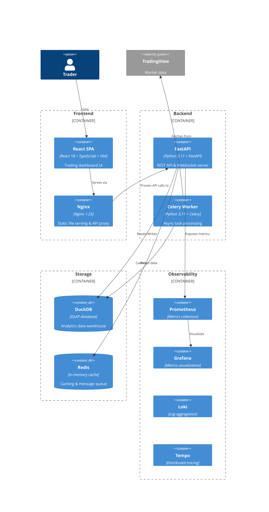
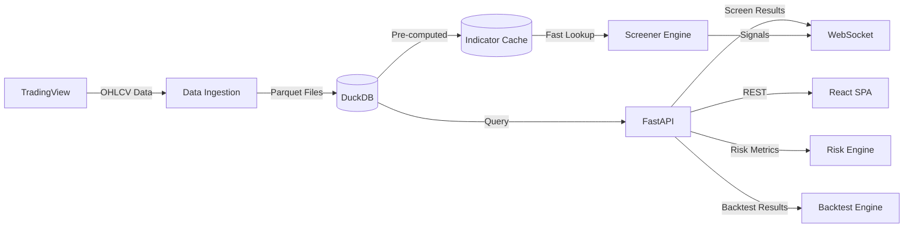

# Phase 10: Production Hardening — Plan

**Goal:** Transform the conflu.ai trading platform from a feature-complete application into a production-ready system covering CI/CD pipeline, containerization, observability, documentation, and performance optimization.

**Success Criteria:**
1. GitHub Actions CI/CD (lint, type-check, test, build, deploy) with matrix strategy
2. Multi-stage Dockerfile with uv installs, distroless runtime for backend, nginx for frontend
3. Prometheus/Grafana dashboards with Loki log aggregation and OTLP trace export
4. Comprehensive documentation (API, architecture, developer guide, user guide) via MkDocs Material
5. Performance benchmarks with CI gates: 5000 symbols < 30s, 10yr backtest < 2s, API p95 < 200ms

**must_haves:**
1. CI pipeline must pass on every PR to main
2. Docker images must be distroless or Alpine, run as non-root, with health checks
3. Prometheus must expose `/metrics` with API latency, error rates, cache hit rates
4. Documentation must be auto-deployed to GitHub Pages
5. k6 load tests must gate CI on p95 < 200ms for API endpoints
6. Security scanning (Trivy, TruffleHog, pip-audit, npm audit) must run in CI
7. Renovate must be configured for automated dependency update PRs

---

## Wave 1: CI/CD Foundation & Container Hardening

**Wave goal:** Establish the CI/CD pipeline and production-ready Docker images that everything else depends on.

### Task 1.1: Production Backend Dockerfile with uv + Distroless

<read_first>
- `Dockerfile` (current backend Dockerfile)
- `pyproject.toml` (dependencies)
- `backend/setup.py` (package config)
</read_first>

<action>
Replace `C:\_Code\conflu.ai\Dockerfile` with a 3-stage Dockerfile:

**Stage 1 — uv-builder**: `FROM python:3.11-slim AS builder`
- Install `uv` via pip (`pip install uv`)
- Copy only `pyproject.toml`, `backend/setup.py`
- Run `uv pip install --system .` 
- Run `uv pip install --system .[observability]` to include OTEL deps
- Clean pip/uv cache in same layer

**Stage 2 — runtime**: `FROM gcr.io/distroless/python3-debian12:nonroot AS runtime`
- Set `ENV PYTHONPATH=/app`
- Copy installed site-packages from builder: `COPY --from=builder /usr/local/lib/python3.11/site-packages /usr/local/lib/python3.11/site-packages`
- Copy `backend/` to `/app/backend/`
- Copy `config.yaml` to `/app/config.yaml`
- `USER nonroot:nonroot`
- `WORKDIR /app`
- `HEALTHCHECK --interval=30s --timeout=10s --start-period=10s --retries=3 CMD ["python", "-c", "import urllib.request; urllib.request.urlopen('http://localhost:8000/health')"]`
- `EXPOSE 8000`
- `CMD ["python", "-m", "uvicorn", "backend.app.api.main:app", "--host", "0.0.0.0", "--port", "8000"]`
- Add `LABEL org.opencontainers.image.source=https://github.com/keval/conflu.ai`

**Stage 3 — dev**: `FROM runtime AS dev` (use python:3.11-slim base for dev instead of distroless)
- Override to use `python:3.11-slim` base so dev tools (pytest, mypy) are available
- `CMD ["uvicorn", "backend.app.api.main:app", "--host", "0.0.0.0", "--port", "8000", "--reload"]`
</action>

<acceptance_criteria>
- `Dockerfile` contains `FROM gcr.io/distroless/python3-debian12:nonroot AS runtime`
- `Dockerfile` contains `RUN pip install uv && uv pip install --system .`
- `Dockerfile` contains `USER nonroot:nonroot`
- `Dockerfile` contains `HEALTHCHECK` with `CMD ["python", "-c", "import urllib.request..."]`
- `Dockerfile` contains `LABEL org.opencontainers.image.source=`
- `Dockerfile` contains `AS dev` stage
- `docker build --target runtime -t conflu-backend .` exits 0
</acceptance_criteria>

---

### Task 1.2: Production Frontend Dockerfile with Brotli + Security Hardening

<read_first>
- `frontend/Dockerfile` (current frontend Dockerfile)
- `frontend/nginx.conf` (current nginx config)
</read_first>

<action>
Replace `C:\_Code\conflu.ai\frontend\Dockerfile` with a 2-stage Dockerfile with brotli support and non-root nginx:

**Stage 1 — builder**: `FROM node:20-alpine AS builder`
- Keep existing: `WORKDIR /app`, `COPY package.json package-lock.json ./`, `RUN npm ci --frozen-lockfile`, `COPY . .`, `RUN npm run build`

**Stage 2 — runtime**: `FROM nginxinc/nginx-unprivileged:1.25-alpine-slim`
- `USER nginx` (default for unprivileged image)
- Copy custom nginx config: `COPY nginx.conf /etc/nginx/conf.d/default.conf`
- Copy built assets: `COPY --from=builder /app/dist /usr/share/nginx/html`
- Enable brotli: In `nginx.conf`, add `brotli on; brotli_types text/plain text/css application/json application/javascript text/xml application/xml text/javascript image/svg+xml; brotli_min_length 256;`
- `HEALTHCHECK --interval=30s --timeout=3s --start-period=5s --retries=3 CMD ["wget", "--no-verbose", "--tries=1", "--spider", "http://localhost:80/"]`
- `EXPOSE 80`

Update `C:\_Code\conflu.ai\frontend\nginx.conf`:
- Add `brotli on;` and `brotli_types ...` after the existing `gzip` block
- Add security headers in the `location /` block: `add_header X-Frame-Options "SAMEORIGIN" always; add_header X-Content-Type-Options "nosniff" always; add_header Referrer-Policy "strict-origin-when-cross-origin" always;`
</action>

<acceptance_criteria>
- `frontend/Dockerfile` contains `FROM nginxinc/nginx-unprivileged:1.25-alpine-slim`
- `frontend/Dockerfile` contains `HEALTHCHECK` with `CMD ["wget"...]`
- `frontend/nginx.conf` contains `brotli on;`
- `frontend/nginx.conf` contains `X-Frame-Options "SAMEORIGIN"`
- `frontend/nginx.conf` contains `X-Content-Type-Options "nosniff"`
- `frontend/nginx.conf` contains `Referrer-Policy "strict-origin-when-cross-origin"`
- `docker build -f frontend/Dockerfile -t conflu-frontend ./frontend` exits 0
</acceptance_criteria>

---

### Task 1.3: Docker Compose Override Pattern (Dev vs Prod)

<read_first>
- `docker-compose.yml` (current compose)
- `Dockerfile` (to confirm targets match)
</read_first>

<action>

Create `C:\_Code\conflu.ai\docker-compose.override.yml` for local development:
```yaml
services:
  api:
    build:
      target: dev
    volumes:
      - ./backend:/app/backend
      - ./config.yaml:/app/config.yaml
    environment:
      - CONFLU_CORE__LOG_LEVEL=DEBUG
    ports:
      - "5678:5678"  # debugpy

  worker:
    build:
      target: dev
    volumes:
      - ./backend:/app/backend
      - ./config.yaml:/app/config.yaml
    environment:
      - CONFLU_CORE__LOG_LEVEL=DEBUG

  frontend:
    build:
      target: builder
    command: ["npm", "run", "dev", "--", "--host", "0.0.0.0"]
    ports:
      - "5173:5173"
    volumes:
      - ./frontend/src:/app/src
```

Create `C:\_Code\conflu.ai\docker-compose.prod.yml` for production:
```yaml
services:
  api:
    build:
      target: runtime
    restart: always
    deploy:
      resources:
        limits:
          memory: 2G
        reservations:
          memory: 1G

  worker:
    build:
      target: runtime
    restart: always
    deploy:
      resources:
        limits:
          memory: 4G
        reservations:
          memory: 2G

  frontend:
    restart: always
    deploy:
      resources:
        limits:
          memory: 512M
        reservations:
          memory: 256M

  redis:
    restart: always
    deploy:
      resources:
        limits:
          memory: 1G
        reservations:
          memory: 512M
```

Update `C:\_Code\conflu.ai\docker-compose.yml`:
- Change api build target to `runtime` (prod default): add `target: runtime` under `build:`
- Change frontend build target to `builder` (prod default): add `target: builder` under `build:`
</action>

<acceptance_criteria>
- `docker-compose.override.yml` exists with `api`, `worker`, `frontend` services
- `docker-compose.override.yml` has `target: dev` for api service
- `docker-compose.prod.yml` exists with memory limits for all services
- `docker-compose.yml` api build has `target: runtime`
- `docker-compose.yml` frontend build has `target: builder`
- `docker-compose.override.yml` is in `.gitignore`
</acceptance_criteria>

---

### Task 1.4: GitHub Actions CI Workflow (Lint, Test, Build)

<read_first>
- `.github/workflows/` (currently empty directory)
- `pyproject.toml` (test/mypy/ruff config)
- `frontend/package.json` (lint, typecheck, build scripts)
</read_first>

<action>
Create `C:\_Code\conflu.ai\.github\workflows\ci.yml`:

```yaml
name: CI

on:
  push:
    branches: [main]
  pull_request:
    branches: [main]
  workflow_dispatch:

concurrency:
  group: ${{ github.workflow }}-${{ github.ref }}
  cancel-in-progress: true

env:
  REGISTRY: ghcr.io
  IMAGE_NAME: ${{ github.repository }}

jobs:
  lint-backend:
    name: Lint & Type Check (Backend)
    runs-on: ubuntu-latest
    strategy:
      matrix:
        python-version: ["3.11", "3.12"]
    steps:
      - uses: actions/checkout@v4
      - uses: actions/setup-python@v5
        with:
          python-version: ${{ matrix.python-version }}
          cache: pip
      - run: pip install uv
      - run: uv pip install --system ".[dev,test]"
      - run: ruff check backend/
      - run: ruff format --check backend/
      - run: mypy backend/ --strict

  lint-frontend:
    name: Lint & Type Check (Frontend)
    runs-on: ubuntu-latest
    strategy:
      matrix:
        node-version: ["20", "22"]
    steps:
      - uses: actions/checkout@v4
      - uses: actions/setup-node@v4
        with:
          node-version: ${{ matrix.node-version }}
          cache: npm
          cache-dependency-path: frontend/package-lock.json
      - run: npm ci --frozen-lockfile
        working-directory: frontend
      - run: npm run lint
        working-directory: frontend
      - run: npm run typecheck
        working-directory: frontend

  test-backend:
    name: Test (Backend)
    needs: [lint-backend]
    runs-on: ubuntu-latest
    strategy:
      matrix:
        python-version: ["3.11", "3.12"]
    steps:
      - uses: actions/checkout@v4
      - uses: actions/setup-python@v5
        with:
          python-version: ${{ matrix.python-version }}
          cache: pip
      - run: pip install uv
      - run: uv pip install --system ".[dev,test,observability]"
      - run: pytest backend/tests/ -v --junitxml=test-results.xml --cov=backend/app --cov-report=xml --cov-report=term
      - uses: actions/upload-artifact@v4
        if: always()
        with:
          name: test-results-backend-${{ matrix.python-version }}
          path: test-results.xml
      - uses: actions/upload-artifact@v4
        if: always()
        with:
          name: coverage-backend-${{ matrix.python-version }}
          path: coverage.xml

  security-scan:
    name: Security Scan
    runs-on: ubuntu-latest
    steps:
      - uses: actions/checkout@v4
      - name: Run TruffleHog
        uses: trufflesecurity/trufflehog@main
        with:
          extra_args: --only-verified
      - name: Run pip-audit
        run: |
          pip install uv
          uv pip install --system ".[dev,test,observability]"
          pip install pip-audit
          pip-audit
      - name: Run npm audit
        working-directory: frontend
        run: npm audit --audit-level=high
      - name: Run Trivy on repo
        uses: aquasecurity/trivy-action@master
        with:
          scan-type: fs
          scan-ref: .
          format: table
          exit-code: 1
          severity: HIGH,CRITICAL

  docker-build:
    name: Build Docker Images
    needs: [test-backend, lint-frontend]
    runs-on: ubuntu-latest
    steps:
      - uses: actions/checkout@v4
      - name: Set up Docker Buildx
        uses: docker/setup-buildx-action@v3
      - name: Log in to GHCR
        uses: docker/login-action@v3
        with:
          registry: ${{ env.REGISTRY }}
          username: ${{ github.actor }}
          password: ${{ secrets.GITHUB_TOKEN }}
      - name: Extract metadata
        id: meta
        uses: docker/metadata-action@v5
        with:
          images: ${{ env.REGISTRY }}/${{ env.IMAGE_NAME }}
          tags: |
            type=ref,event=branch
            type=sha,prefix=
            type=raw,value=latest,enable=${{ github.ref == 'refs/heads/main' }}
      - name: Build & push backend
        uses: docker/build-push-action@v6
        with:
          context: .
          push: ${{ github.event_name != 'pull_request' }}
          tags: ${{ steps.meta.outputs.tags }}
          labels: ${{ steps.meta.outputs.labels }}
          target: runtime
          cache-from: type=gha
          cache-to: type=gha,mode=max
      - name: Build & push frontend
        uses: docker/build-push-action@v6
        with:
          context: ./frontend
          push: ${{ github.event_name != 'pull_request' }}
          tags: ${{ steps.meta.outputs.tags }}-frontend
          labels: ${{ steps.meta.outputs.labels }}
          cache-from: type=gha
          cache-to: type=gha,mode=max
      - name: Generate SBOM
        uses: aquasecurity/trivy-action@master
        with:
          scan-type: image
          scan-ref: ${{ env.REGISTRY }}/${{ env.IMAGE_NAME }}:latest
          format: spdx-json
          output: sbom.spdx.json
      - uses: actions/upload-artifact@v4
        with:
          name: sbom
          path: sbom.spdx.json
```

Create `C:\_Code\conflu.ai\.github\workflows\deploy.yml`:

```yaml
name: Deploy

on:
  workflow_run:
    workflows: [CI]
    branches: [main]
    types: [completed]
  workflow_dispatch:

jobs:
  deploy-staging:
    name: Deploy to Staging
    runs-on: ubuntu-latest
    if: ${{ github.event_name == 'workflow_dispatch' || github.event.workflow_run.conclusion == 'success' }}
    environment:
      name: staging
      url: https://staging.conflu.ai
    steps:
      - uses: actions/checkout@v4
      - name: Deploy via SSH
        run: |
          echo "Deploying to staging..."
          # Placeholder: add actual deploy commands
          # ssh deploy-user@staging "docker compose -f docker-compose.yml -f docker-compose.prod.yml pull && docker compose -f docker-compose.yml -f docker-compose.prod.yml up -d"
        env:
          DEPLOY_KEY: ${{ secrets.DEPLOY_KEY }}

  deploy-production:
    name: Deploy to Production
    needs: [deploy-staging]
    runs-on: ubuntu-latest
    environment:
      name: production
      url: https://conflu.ai
    steps:
      - uses: actions/checkout@v4
      - name: Deploy via SSH
        run: |
          echo "Deploying to production..."
          # Placeholder: add actual deploy commands
        env:
          DEPLOY_KEY: ${{ secrets.DEPLOY_KEY }}
```

Create `C:\_Code\conflu.ai\.github\workflows\reusable-test.yml`:

```yaml
name: Reusable Test Workflow

on:
  workflow_call:
    inputs:
      python-version:
        required: true
        type: string

jobs:
  test:
    runs-on: ubuntu-latest
    steps:
      - uses: actions/checkout@v4
      - uses: actions/setup-python@v5
        with:
          python-version: ${{ inputs.python-version }}
          cache: pip
      - run: pip install uv
      - run: uv pip install --system ".[dev,test]"
      - run: pytest backend/tests/ -v --junitxml=test-results.xml
      - uses: actions/upload-artifact@v4
        if: always()
        with:
          name: test-results-${{ inputs.python-version }}
          path: test-results.xml
```

Create `C:\_Code\conflu.ai\.github\workflows\reusable-docker.yml`:

```yaml
name: Reusable Docker Build

on:
  workflow_call:
    inputs:
      target:
        required: true
        type: string
      image-suffix:
        required: false
        type: string
        default: ""

jobs:
  build:
    runs-on: ubuntu-latest
    steps:
      - uses: actions/checkout@v4
      - uses: docker/setup-buildx-action@v3
      - uses: docker/login-action@v3
        with:
          registry: ghcr.io
          username: ${{ github.actor }}
          password: ${{ secrets.GITHUB_TOKEN }}
      - uses: docker/build-push-action@v6
        with:
          context: .
          push: ${{ github.event_name != 'pull_request' }}
          tags: ghcr.io/${{ github.repository }}${{ inputs.image-suffix }}:${{ github.sha }}
          target: ${{ inputs.target }}
          cache-from: type=gha
          cache-to: type=gha,mode=max
```
</action>

<acceptance_criteria>
- `.github/workflows/ci.yml` exists with `lint-backend`, `lint-frontend`, `test-backend`, `security-scan`, `docker-build` jobs
- `.github/workflows/ci.yml` contains `matrix` with `python-version: ["3.11", "3.12"]`
- `.github/workflows/ci.yml` contains `matrix` with `node-version: ["20", "22"]`
- `.github/workflows/ci.yml` uses `ruff`, `mypy`, `pytest`, `trivy-action`
- `.github/workflows/deploy.yml` exists with `deploy-staging` and `deploy-production` jobs
- `.github/workflows/reusable-test.yml` exists with `workflow_call` trigger
- `.github/workflows/reusable-docker.yml` exists with `workflow_call` trigger
- All YAML files parse without syntax errors
</acceptance_criteria>

---

### Task 1.5: Security Tooling Configuration

<read_first>
- `pyproject.toml` (existing dev deps include pre-commit)
- `.pre-commit-config.yaml` (existing pre-commit hooks)
</read_first>

<action>

Create `C:\_Code\conflu.ai\renovate.json`:
```json
{
  "$schema": "https://docs.renovatebot.com/renovate-schema.json",
  "extends": [
    "config:recommended",
    ":separateMajorMinor",
    ":combinePatchMinorUpdates",
    ":automergePatch"
  ],
  "labels": ["dependencies"],
  "assignees": ["keval"],
  "packageRules": [
    {
      "matchUpdateTypes": ["minor", "patch"],
      "automerge": true
    },
    {
      "matchManagers": ["pip_requirements", "pip_setup"],
      "groupName": "Python dependencies",
      "matchDepTypes": ["dependencies", "devDependencies"]
    },
    {
      "matchManagers": ["npm"],
      "groupName": "Frontend dependencies",
      "matchDepTypes": ["dependencies", "devDependencies"]
    }
  ],
  "pip-compile": {
    "enabled": false
  },
  "npm": {
    "enabled": true
  }
}
```

Create `C:\_Code\conflu.ai\.trufflehog.ini`:
```ini
# TruffleHog configuration
# Exclude test files and config templates from secret scanning
[trufflehog]
exclude_paths = ["backend/tests/", "frontend/src/__tests__/", "*.md"]

# Only show verified secrets
verify = true
```

Create `C:\_Code\conflu.ai\.trivyignore`:
```
# Ignore specific vulnerabilities with expiry dates
# Example: CVE-2023-XXXXX expires="2024-12-31"
# No current ignores - review periodically
```

Update `.pre-commit-config.yaml` to add TruffleHog hook:
- Add after the mypy hook:
```yaml
  - repo: https://github.com/kevinconway/trufflehog-precommit
    rev: v3.82.0
    hooks:
      - id: trufflehog
        args: ["--only-verified"]
```
</action>

<acceptance_criteria>
- `renovate.json` exists with `config:recommended` extends
- `.trufflehog.ini` exists with `exclude_paths` config
- `.trivyignore` exists (can be empty comment)
- `.pre-commit-config.yaml` contains `trufflehog` hook
- `renovate.json` has `packageRules` for Python and npm
</acceptance_criteria>

---

## Wave 2: Observability Stack

**Wave goal:** Deploy Prometheus + Grafana + Loki + Tempo with pre-built dashboards and alerting rules for production monitoring.

### Task 2.1: Prometheus Configuration

<read_first>
- `docker-compose.yml` (to understand service network)
- `backend/app/api/observability.py` (existing Prometheus setup)
</read_first>

<action>

Create `C:\_Code\conflu.ai\config\prometheus\prometheus.yml`:
```yaml
global:
  scrape_interval: 15s
  evaluation_interval: 15s

alerting:
  alertmanagers:
    - static_configs:
        - targets: []

rule_files:
  - "alerts.yml"

scrape_configs:
  - job_name: "conflu-api"
    static_configs:
      - targets: ["api:8000"]
    metrics_path: "/metrics"
    scrape_interval: 10s

  - job_name: "prometheus"
    static_configs:
      - targets: ["localhost:9090"]

  - job_name: "loki"
    static_configs:
      - targets: ["loki:3100"]
```

Create `C:\_Code\conflu.ai\config\prometheus\alerts.yml`:
```yaml
groups:
  - name: conflu-api
    rules:
      - alert: HighErrorRate
        expr: rate(http_requests_total{status=~"5.."}[5m]) / rate(http_requests_total[5m]) > 0.05
        for: 5m
        labels:
          severity: critical
        annotations:
          summary: "API error rate > 5% over 5m"
          description: "Error rate is {{ $value | humanizePercentage }} for the last 5 minutes"

      - alert: HighLatency
        expr: histogram_quantile(0.95, rate(http_request_duration_seconds_bucket[5m])) > 0.2
        for: 5m
        labels:
          severity: warning
        annotations:
          summary: "API p95 latency > 200ms"
          description: "p95 latency is {{ $value }}s over 5m"

      - alert: HighWebSocketErrors
        expr: rate(ws_errors_total[5m]) > 0.1
        for: 5m
        labels:
          severity: warning
        annotations:
          summary: "WebSocket error rate > 0.1/s"
          description: "WebSocket error rate is {{ $value }}/s over 5m"

      - alert: RateLimitExceeded
        expr: rate(rate_limit_exceeded_total[5m]) > 10
        for: 5m
        labels:
          severity: info
        annotations:
          summary: "Rate limit exceeded frequently"
          description: "Rate limit exceeded {{ $value }} times/s over 5m"

      - alert: ServiceDown
        expr: up{job="conflu-api"} == 0
        for: 1m
        labels:
          severity: critical
        annotations:
          summary: "API service is down"
          description: "conflu-api has been unreachable for 1 minute"

      - alert: CacheHitRateLow
        expr: rate(cache_hits_total[5m]) / (rate(cache_hits_total[5m]) + rate(cache_misses_total[5m])) < 0.5
        for: 10m
        labels:
          severity: warning
        annotations:
          summary: "Indicator cache hit rate < 50%"
          description: "Cache hit rate is {{ $value | humanizePercentage }} over 10m"
```
</action>

<acceptance_criteria>
- `config/prometheus/prometheus.yml` exists with `conflu-api` scrape job targeting `api:8000`
- `config/prometheus/alerts.yml` exists with groups containing `HighErrorRate`, `HighLatency`, `ServiceDown` rules
- Each alert has `expr`, `for`, `labels.severity`, `annotations.summary`
- `prometheus.yml` references `alerts.yml` in `rule_files`
</acceptance_criteria>

---

### Task 2.2: Grafana Dashboards with Provisioning

<read_first>
- `config/prometheus/alerts.yml` (alert rules to reference)
- `docker-compose.yml` (service names)
</read_first>

<action>

Create `C:\_Code\conflu.ai\config\grafana\datasources\datasources.yml`:
```yaml
apiVersion: 1

datasources:
  - name: Prometheus
    type: prometheus
    access: proxy
    url: http://prometheus:9090
    isDefault: true
    editable: false

  - name: Loki
    type: loki
    access: proxy
    url: http://loki:3100
    editable: false

  - name: Tempo
    type: tempo
    access: proxy
    url: http://tempo:3200
    editable: false
```

Create `C:\_Code\conflu.ai\config\grafana\dashboards\api-overview.json` with a JSON dashboard containing:
- **Row 1: Request Rate & Errors** — Panel: "Request Rate" (rate(http_requests_total[5m])), Panel: "Error Rate" (rate(http_requests_total{status=~"5.."}[5m]) / rate(http_requests_total[5m])), Panel: "Active WebSocket Connections" (ws_connections_active)
- **Row 2: Latency** — Panel: "p50/p95/p99 Latency" (histogram_quantile queries on http_request_duration_seconds_bucket at 0.5, 0.95, 0.99)
- **Row 3: Cache & Rate Limits** — Panel: "Cache Hit Rate" (rate(cache_hits_total[5m]) / (rate(cache_hits_total[5m]) + rate(cache_misses_total[5m])) * 100), Panel: "Rate Limit Exceeded" (rate(rate_limit_exceeded_total[5m]))
- **Row 4: Business Metrics** — Panel: "Active Screens" (placeholder gauge), Panel: "Active Backtests" (placeholder gauge)

Create `C:\_Code\conflu.ai\config\grafana\dashboards\dashboards.yml`:
```yaml
apiVersion: 1

providers:
  - name: "Conflu AI"
    orgId: 1
    folder: "Conflu AI"
    type: file
    disableDeletion: false
    updateIntervalSeconds: 30
    options:
      path: /etc/grafana/provisioning/dashboards
```
</action>

<acceptance_criteria>
- `config/grafana/datasources/datasources.yml` exists with Prometheus, Loki, Tempo datasources
- `config/grafana/dashboards/api-overview.json` exists with at least 4 panels across 4 rows
- `config/grafana/dashboards/dashboards.yml` exists with provider config
- `api-overview.json` contains `"title": "Conflu AI - API Overview"`
- `api-overview.json` contains `"expr": "rate(http_requests_total[5m])"`
- `api-overview.json` contains `"expr": "ws_connections_active"`
</acceptance_criteria>

---

### Task 2.3: Loki + Tempo + OTEL Collector Configuration

<read_first>
- `docker-compose.yml` (services and network)
- `config/prometheus/prometheus.yml` (existing prom config for reference)
</read_first>

<action>

Create `C:\_Code\conflu.ai\config\loki\loki-config.yml`:
```yaml
auth_enabled: false

server:
  http_listen_port: 3100

common:
  ring:
    instance_addr: 127.0.0.1
    kvstore:
      store: inmemory
  replication_factor: 1
  path_prefix: /tmp/loki

schema_config:
  configs:
    - from: 2024-01-01
      store: boltdb-shipper
      object_store: filesystem
      schema: v11
      index:
        prefix: index_
        period: 24h

storage_config:
  boltdb_shipper:
    active_index_directory: /tmp/loki/index
    cache_location: /tmp/loki/cache
  filesystem:
    directory: /tmp/loki/chunks

limits_config:
  enforce_metric_name: false
  reject_old_samples: true
  reject_old_samples_max_age: 168h
```

Create `C:\_Code\conflu.ai\config\tempo\tempo-config.yml`:
```yaml
server:
  http_listen_port: 3200

distributor:
  receivers:
    otlp:
      protocols:
        grpc:
          endpoint: "0.0.0.0:4317"
        http:
          endpoint: "0.0.0.0:4318"

ingester:
  trace_idle_period: 10s
  max_block_duration: 5m

compactor:
  compaction:
    block_retention: 48h

storage:
  trace:
    backend: local
    local:
      path: /tmp/tempo/traces
    wal:
      path: /tmp/tempo/wal
```

Create `C:\_Code\conflu.ai\config\otel-collector\otel-collector-config.yml`:
```yaml
receivers:
  otlp:
    protocols:
      grpc:
        endpoint: 0.0.0.0:4317
      http:
        endpoint: 0.0.0.0:4318

processors:
  batch:
    timeout: 1s
    send_batch_size: 1024

exporters:
  otlp:
    endpoint: tempo:4317
    tls:
      insecure: true
  logging:
    loglevel: debug

service:
  pipelines:
    traces:
      receivers: [otlp]
      processors: [batch]
      exporters: [otlp, logging]
```

Update `C:\_Code\conflu.ai\docker-compose.yml` to add observability services:
```yaml
  prometheus:
    image: prom/prometheus:latest
    container_name: conflu-prometheus
    volumes:
      - ./config/prometheus:/etc/prometheus
      - prometheus_data:/prometheus
    ports:
      - "9090:9090"
    command:
      - '--config.file=/etc/prometheus/prometheus.yml'
      - '--storage.tsdb.path=/prometheus'
    restart: unless-stopped
    networks:
      - default

  grafana:
    image: grafana/grafana:latest
    container_name: conflu-grafana
    volumes:
      - ./config/grafana/datasources:/etc/grafana/provisioning/datasources
      - ./config/grafana/dashboards:/etc/grafana/provisioning/dashboards
      - grafana_data:/var/lib/grafana
    ports:
      - "3000:3000"
    environment:
      - GF_SECURITY_ADMIN_PASSWORD=admin
      - GF_INSTALL_PLUGINS=grafana-piechart-panel
    restart: unless-stopped
    depends_on:
      - prometheus
    networks:
      - default

  loki:
    image: grafana/loki:latest
    container_name: conflu-loki
    volumes:
      - ./config/loki:/etc/loki
      - loki_data:/loki
    ports:
      - "3100:3100"
    command: -config.file=/etc/loki/loki-config.yml
    restart: unless-stopped
    networks:
      - default

  tempo:
    image: grafana/tempo:latest
    container_name: conflu-tempo
    volumes:
      - ./config/tempo:/etc/tempo
      - tempo_data:/tmp/tempo
    ports:
      - "3200:3200"
      - "4317:4317"
      - "4318:4318"
    command: -config.file=/etc/tempo/tempo-config.yml
    restart: unless-stopped
    networks:
      - default

  otel-collector:
    image: otel/opentelemetry-collector-contrib:latest
    container_name: conflu-otel-collector
    volumes:
      - ./config/otel-collector:/etc/otel
    command: --config=/etc/otel/otel-collector-config.yml
    ports:
      - "4317:4317"
      - "4318:4318"
    depends_on:
      - tempo
    restart: unless-stopped
    networks:
      - default
```

Also add new volumes at the bottom of `docker-compose.yml`:
```yaml
volumes:
  redis_data:
  prometheus_data:
  grafana_data:
  loki_data:
  tempo_data:
```
</action>

<acceptance_criteria>
- `config/loki/loki-config.yml` exists with `http_listen_port: 3100`
- `config/tempo/tempo-config.yml` exists with OTLP receiver on `4317`
- `config/otel-collector/otel-collector-config.yml` exists with OTLP receiver and tempo exporter
- `docker-compose.yml` contains `prometheus`, `grafana`, `loki`, `tempo`, `otel-collector` services
- `docker-compose.yml` volumes section includes `prometheus_data`, `grafana_data`, `loki_data`, `tempo_data`
- `config/otel-collector/otel-collector-config.yml` has `exporters.otlp.endpoint: tempo:4317`
</acceptance_criteria>

---

## Wave 3: Documentation

**Wave goal:** Comprehensive documentation portal with MkDocs Material, auto-generated API reference, architecture diagrams, developer guide, and GitHub Pages deployment.

### Task 3.1: MkDocs Material Setup with GitHub Pages

<read_first>
- `docs/` (existing docs directory with ARCHITECTURE.md, API.md, DECISIONS/, SESSIONS/)
</read_first>

<action>

Create `C:\_Code\conflu.ai\mkdocs.yml`:
```yaml
site_name: conflu.ai Documentation
site_description: Professional Multi-Asset Trading Platform
site_author: conflu.ai Team
site_url: https://keval.github.io/conflu.ai/

repo_name: keval/conflu.ai
repo_url: https://github.com/keval/conflu.ai

theme:
  name: material
  palette:
    primary: indigo
    accent: indigo
  features:
    - navigation.tabs
    - navigation.sections
    - navigation.expand
    - navigation.path
    - navigation.indexes
    - toc.follow
    - search.suggest
    - search.highlight
    - content.code.copy
    - content.code.annotate

plugins:
  - search
  - mkdocstrings:
      handlers:
        python:
          paths: [backend]
          options:
            show_source: true
            show_root_heading: true
            heading_level: 3
  - gen-files:
      scripts:
        - docs/scripts/gen_api_ref.py
  - literate-nav:
      nav_file: NAV.md
  - section-index
  - git-revision-date-localized:
      enable_creation_date: true

markdown_extensions:
  - admonition
  - pymdownx.details
  - pymdownx.superfences
  - pymdownx.tabbed:
      alternate_style: true
  - pymdownx.highlight:
      anchor_linenums: true
  - pymdownx.inlinehilite
  - pymdownx.snippets
  - pymdownx.emoji
  - tables
  - toc:
      permalink: true

extra:
  social:
    - icon: fontawesome/brands/github
      link: https://github.com/keval/conflu.ai

nav:
  - Home: index.md
  - Getting Started: getting-started.md
  - User Guide:
      - Screener: user-guide/screener.md
      - Backtesting: user-guide/backtest.md
      - Risk Management: user-guide/risk.md
      - Alerts: user-guide/alerts.md
  - API Reference: api/
  - Architecture: architecture.md
  - Developer Guide:
      - Contributing: dev-guide/contributing.md
      - Local Setup: dev-guide/local-setup.md
      - Coding Standards: dev-guide/coding-standards.md
      - Debugging: dev-guide/debugging.md
  - Decisions: decisions/
  - Changelog: changelog.md
```

Create `C:\_Code\conflu.ai\docs\index.md`:
```markdown
# conflu.ai Documentation

Welcome to the conflu.ai documentation. conflu.ai is a professional multi-asset trading platform with vectorized screening, backtesting, and risk management.

## Quick Links

- [Getting Started](getting-started.md) — Set up your local development environment
- [API Reference](api/) — Auto-generated API documentation
- [Architecture](architecture.md) — System architecture and data flow
- [Developer Guide](dev-guide/contributing.md) — How to contribute
- [Changelog](changelog.md) — Release history

## Key Features

- **Multi-Asset Screening** — Screen 5000+ symbols across equities, crypto, forex, commodities, and indices
- **Vectorized Backtesting** — Fast backtesting with vectorbt portfolio simulation
- **Risk Management** — ATR position sizing, VaR, beta hedging, Kelly optimization
- **Real-Time Streaming** — WebSocket-based price and indicator streaming
- **Advanced Analytics** — Parameter optimization, regime detection, report generation
```

Create `C:\_Code\conflu.ai\docs\scripts\gen_api_ref.py`:
```python
"""Generate API reference pages from FastAPI OpenAPI spec."""
from __future__ import annotations

from pathlib import Path


def generate_api_reference() -> None:
    """Generate placeholder API reference pages for MkDocs.
    
    In production, this uses the running API's OpenAPI spec.
    """
    api_dir = Path("docs/api")
    api_dir.mkdir(parents=True, exist_ok=True)
    
    endpoints = {
        "health.md": "# Health\n\n## GET /health\nLiveness check.\n\n## GET /health/ready\nReadiness check with DuckDB connectivity.\n",
        "screener.md": "# Screener API\n\n## POST /api/v1/screen\nRun a multi-timeframe screener.\n\n## GET /api/v1/screens\nList saved screen configurations.\n\n## POST /api/v1/screens\nSave a screen configuration.\n",
        "backtest.md": "# Backtest API\n\n## POST /api/v1/backtest\nRun a new backtest.\n\n## POST /api/v1/backtest/optimize-v2\nRun parameter optimization.\n\n## POST /api/v1/backtest/compare\nCompare multiple backtest runs.\n",
        "data.md": "# Data API\n\n## GET /api/v1/data/{symbol}\nGet OHLCV data for a symbol.\n\n## GET /api/v1/indicators/{symbol}\nGet computed indicators for a symbol.\n",
        "risk.md": "# Risk API\n\n## GET /api/v1/risk/{symbol}/beta\nGet beta vs benchmark.\n\n## GET /api/v1/risk/{portfolio}/var\nGet VaR/CVaR.\n\n## POST /api/v1/risk/position-size\nCalculate position size.\n",
        "alerts.md": "# Alerts API\n\n## GET /api/v1/alerts\nList alerts.\n\n## POST /api/v1/alerts\nCreate an alert.\n\n## DELETE /api/v1/alerts/{alert_id}\nDelete an alert.\n",
        "streaming.md": "# WebSocket Streaming\n\n## WebSocket /api/v1/ws/stream\nReal-time price and indicator streaming.\n\n## WebSocket /api/v1/ws/screener/{screen_id}\nReal-time screener results.\n",
    }
    
    for filename, content in endpoints.items():
        (api_dir / filename).write_text(content)


if __name__ == "__main__":
    generate_api_reference()
```

Create `C:\_Code\conflu.ai\docs\getting-started.md`:
```markdown
# Getting Started

## Prerequisites

- Python 3.11+
- Node.js 20+
- Docker & Docker Compose v2
- Git

## Local Development Setup

### 1. Clone the Repository

```bash
git clone https://github.com/keval/conflu.ai.git
cd conflu.ai
```

### 2. Backend Setup

```bash
# Create virtual environment
python -m venv .venv
source .venv/bin/activate  # On Windows: .venv\Scripts\activate

# Install with uv (recommended)
pip install uv
uv pip install -e ".[dev,test,observability]"

# Or with pip
pip install -e ".[dev,test,observability]"
```

### 3. Frontend Setup

```bash
cd frontend
npm install
```

### 4. Run with Docker Compose

```bash
docker compose up -d
```

### 5. Verify Installation

```bash
# Health check
curl http://localhost:8000/health

# Should return:
# {"status":"ok","service":"conflu-api","version":"0.2.0"}
```

## Configuration

See `config.yaml` for all configuration options. Environment variables override YAML settings:

- `CONFLU_CORE__LOG_LEVEL=DEBUG` for verbose logging
- `CONFLU_CORE__DUCKDB_PATH=/path/to/custom.duckdb` for custom database path

## Running Tests

```bash
# Backend tests
pytest backend/tests/ -v

# Frontend lint and type check
cd frontend && npm run lint && npm run typecheck
```
```

Create `C:\_Code\conflu.ai\docs\architecture.md` with Mermaid C4 diagrams:
```markdown
# Architecture

## System Context (C4 Level 1)



## Container Diagram (C4 Level 2)



## Data Flow



## Technology Stack

| Layer | Technology | Purpose |
|-------|-----------|---------|
| Frontend | React 18, TypeScript, Vite | UI framework & build |
| Charts | TradingView Lightweight Charts | Financial charts |
| Styling | Tailwind CSS | Utility-first CSS |
| State | Zustand + React Query | Client state & server cache |
| Backend | Python 3.11, FastAPI | REST API & WebSocket |
| Database | DuckDB | OLAP analytics (columnar) |
| Cache | Redis | In-memory cache & queue |
| Data Source | tradingview-screener | Market data |
| Metrics | Prometheus + Grafana | Observability |
| Logs | structlog + Loki | Structured logging |
| Tracing | OpenTelemetry + Tempo | Distributed tracing |
| Compute | vectorbt + pandas-ta | Vectorized indicators & backtesting |
| CI/CD | GitHub Actions | Automation |
```

Update existing `C:\_Code\conflu.ai\docs\ARCHITECTURE.md` to reference the MkDocs version:
- Add a note at the top: "This file is auto-generated from the MkDocs source at `docs/architecture.md`. Edit that file instead."
- Keep the existing content, it's complementary

</action>

<acceptance_criteria>
- `mkdocs.yml` exists with `site_name: conflu.ai Documentation`
- `mkdocs.yml` uses `theme.name: material`
- `mkdocs.yml` has `plugins` including `search`, `mkdocstrings`, `gen-files`, `literate-nav`
- `mkdocs.yml` `nav` section includes Home, Getting Started, User Guide, API Reference, Architecture, Developer Guide, Decisions, Changelog
- `docs/index.md` exists with welcome content
- `docs/architecture.md` exists with Mermaid `C4Context` and `C4Container` diagrams
- `docs/getting-started.md` exists with setup instructions
- `docs/scripts/gen_api_ref.py` exists
</acceptance_criteria>

---

### Task 3.2: Developer & User Guide Documentation

<read_first>
- `docs/` (existing docs structure)
- `PROJECT.md` (project vision and constraints)
- `REQUIREMENTS.md` (functional/non-functional requirements)
- `config.yaml` (configuration reference)
</read_first>

<action>

Create `C:\_Code\conflu.ai\docs\dev-guide\contributing.md`:
```markdown
# Contributing

## Development Workflow

1. Create a feature branch from `main`
2. Make changes following the coding standards
3. Write/update tests
4. Run `pytest backend/tests/ -v` to verify
5. Run `mypy backend/ --strict` to type-check
6. Run `ruff check backend/` to lint
7. Create a pull request

## Code Review Checklist

- [ ] Tests pass for all new/modified code
- [ ] mypy strict mode passes
- [ ] ruff linter has no errors
- [ ] Type hints are complete on all public APIs
- [ ] Pydantic models for all request/response schemas
- [ ] Docstrings explain non-trivial logic
- [ ] No Python loops in indicator/signal computation (vectorized only)
- [ ] Async/await for all I/O operations
- [ ] Error handling follows existing patterns

## Commit Convention

We use conventional commits:

```
feat: add ATR position sizing
fix: correct indicator cache invalidation
docs: update API reference
test: add Monte Carlo edge cases
refactor: extract risk engine modules
ci: add GitHub Actions workflow
```
```

Create `C:\_Code\conflu.ai\docs\dev-guide\local-setup.md`:
```markdown
# Local Development Setup

## Quick Start

```bash
# Backend
python -m venv .venv
source .venv/bin/activate
uv pip install -e ".[dev,test,observability]"

# Frontend
cd frontend && npm install

# Run with Docker
docker compose up -d
```

## Environment Variables

| Variable | Default | Description |
|----------|---------|-------------|
| `CONFLU_CORE__LOG_LEVEL` | `INFO` | Log level |
| `CONFLU_CORE__LOG_JSON` | `true` | JSON log output |
| `CONFLU_CORE__DUCKDB_PATH` | `data/conflu.duckdb` | Database path |
| `CONFLU_API__HOST` | `0.0.0.0` | API bind address |
| `CONFLU_API__PORT` | `8000` | API port |
| `CONFLU_API__OTEL_EXPORTER_OTLP_ENDPOINT` | `` | OpenTelemetry endpoint |

## Docker Compose Profiles

- **Default** (`docker compose up`): API, worker, frontend, redis
- **Full Stack** (`docker compose --profile observability up`): Adds Prometheus, Grafana, Loki, Tempo, OTEL collector

## Debugging

- Backend debug port: `5678` (debugpy)
- Frontend dev server: `http://localhost:5173`
- API docs: `http://localhost:8000/docs`
- Grafana: `http://localhost:3000` (admin/admin)
- Prometheus: `http://localhost:9090`
```

Create `C:\_Code\conflu.ai\docs\dev-guide\coding-standards.md`:
```markdown
# Coding Standards

## Python

- **Type hints**: Required on all public functions and methods
- **Docstrings**: Google-style docstrings for all public APIs
- **Line length**: 100 characters (enforced by ruff)
- **Imports**: Use `from __future__ import annotations` at top of every file
- **Formatting**: ruff format (black-compatible)
- **Linting**: ruff with selected rule sets (E,F,I,N,W,UP,B,SIM,ARG,C4)
- **Type checking**: mypy with `--strict` mode

### Zero-Loop Policy

All indicator and signal computation MUST use vectorized operations (pandas/numpy/vectorbt). No explicit Python `for` loops in:
- Indicator calculations
- Signal generation
- Backtest simulations
- Risk computations

### Async Pattern

```python
from backend.app.core.logging import get_logger

log = get_logger(__name__)

async def my_async_function() -> Result:
    log.info("operation_start", param=value)
    result = await some_async_operation()
    log.info("operation_complete", param=value)
    return result
```

## TypeScript/React

- **Strict mode**: `strict: true` in tsconfig
- **No unused locals**: `noUnusedLocals: true`
- **No unused parameters**: `noUnusedParameters: true`
- **Path alias**: `@/` maps to `./src/`
- **State management**: Zustand for global state, React Query for server state
- **Styling**: Tailwind CSS with `clsx` + `tailwind-merge`
```

Create `C:\_Code\conflu.ai\docs\dev-guide\debugging.md`:
```markdown
# Debugging

## Common Issues

### DuckDB Connection Failures
- Ensure `data/` directory exists and is writable
- Check `config.yaml` for correct `duckdb_path`
- Verify no other process has the database locked

### WebSocket Disconnections
- Check Redis connectivity (`redis-cli ping`)
- Verify `ws_max_connections` in config (default: 1000)
- Check WebSocket ping interval (default: 30s)

### Docker Issues
```bash
# View logs
docker compose logs -f api
docker compose logs -f worker

# Rebuild without cache
docker compose build --no-cache api

# Reset data volumes
docker compose down -v
```

### Performance Debugging
```bash
# Profile endpoint
py-spy record -o profile.svg -- python -m uvicorn backend.app.api.main:app

# Check DuckDB query plan
EXPLAIN ANALYZE SELECT * FROM ohlcv WHERE symbol = 'SPY';
```
```

Create `C:\_Code\conflu.ai\docs\user-guide\screener.md`:
```markdown
# Screener Guide

## Running a Screen

Use the screener to find assets matching technical criteria across multiple timeframes.

### Using the API

```bash
curl -X POST http://localhost:8000/api/v1/screen \
  -H "Content-Type: application/json" \
  -d '{
    "symbols": ["SPY", "QQQ", "AAPL"],
    "timeframes": ["1D", "4h"],
    "filters": [
      {"type": "trend", "indicator": "ema_20", "operator": "gt", "value": "ema_50"},
      {"type": "momentum", "indicator": "rsi", "operator": "gt", "value": 50}
    ]
  }'
```

### Filter Types

| Type | Description | Example |
|------|-------------|---------|
| trend | Trend indicators | EMA crossover, SMA slope |
| momentum | Momentum oscillators | RSI > 70, MACD bullish |
| volume | Volume analysis | Volume > avg(20) |
| volatility | Volatility filters | ATR > 2% |
| pattern | Chart patterns | Engulfing, Doji |

## Saving Screens

Saved screens are persisted in DuckDB and can be loaded, shared, and replayed against historical data.

## Alerts

Create alerts that trigger when screen conditions are met, with WebSocket push notifications.
```

Create `C:\_Code\conflu.ai\docs\user-guide\backtest.md`:
```markdown
# Backtesting Guide

## Running a Backtest

```bash
curl -X POST http://localhost:8000/api/v1/backtest \
  -H "Content-Type: application/json" \
  -d '{
    "symbol": "SPY",
    "startDate": "2020-01-01",
    "endDate": "2024-01-01",
    "initialCapital": 100000,
    "strategy": {
      "type": "ema_crossover",
      "fastPeriod": 20,
      "slowPeriod": 50
    }
  }'
```

## Parameter Optimization

```bash
curl -X POST http://localhost:8000/api/v1/backtest/optimize-v2 \
  -H "Content-Type: application/json" \
  -d '{
    "symbol": "SPY",
    "strategyParams": {"type": "ema_crossover"},
    "searchSpace": {
      "method": "bayesian",
      "parameters": {
        "fastPeriod": {"min": 5, "max": 50, "type": "int"},
        "slowPeriod": {"min": 50, "max": 200, "type": "int"}
      },
      "objectives": ["sharpe"],
      "maxTrials": 100
    }
  }'
```

## Comparing Strategies

Compare multiple backtest runs side-by-side with statistical significance testing.
```

Create `C:\_Code\conflu.ai\docs\user-guide\risk.md`:
```markdown
# Risk Management Guide

## Position Sizing

ATR-based position sizing formula:

```
Position Size = (Risk% × Account Equity) / (ATR × ATR Multiplier)
```

## Value at Risk (VaR)

Three methods available:
- **Historical**: Based on historical return distribution
- **Parametric**: Assumes normal distribution
- **Monte Carlo**: Simulated paths with random walks

## Beta Hedging

Rolling 60-day beta vs benchmark:
- Equities: SPY
- Crypto: BTCUSDT
- Forex: EURUSD

## Kelly Criterion

Optimal position sizing from backtest statistics. Half-Kelly (50% fraction) is the default conservative approach.
```

Create `C:\_Code\conflu.ai\docs\user-guide\alerts.md`:
```markdown
# Alerts Guide

## Alert Types

| Type | Triggers When |
|------|---------------|
| Price Threshold | Price crosses a specified level |
| Indicator Cross | Indicator crosses a threshold |
| Signal Trigger | A trading signal is generated |
| Volume Spike | Volume exceeds N× average |
| Trend Break | Trend line or MA is broken |
| Compound | Combination of multiple conditions |

## Managing Alerts

Alerts can be created, listed, dismissed, and deleted via the API or UI. Active alerts are evaluated in a background loop and dispatched via WebSocket.
```
</action>

<acceptance_criteria>
- `docs/dev-guide/contributing.md` exists with development workflow and commit convention
- `docs/dev-guide/local-setup.md` exists with env vars table and Docker profiles
- `docs/dev-guide/coding-standards.md` exists with zero-loop policy and async pattern
- `docs/dev-guide/debugging.md` exists with common issues and troubleshooting
- `docs/user-guide/screener.md` exists with API examples and filter types
- `docs/user-guide/backtest.md` exists with API examples for backtest and optimization
- `docs/user-guide/risk.md` exists with ATR formula and VaR methods
- `docs/user-guide/alerts.md` exists with alert type table
</acceptance_criteria>

---

### Task 3.3: Decision Log Archive (ADR format)

<read_first>
- `docs/DECISIONS/` (existing decision documents)
- `CHANGELOG.md` (existing decision log)
</read_first>

<action>

Create `C:\_Code\conflu.ai\docs\decisions\index.md`:
```markdown
# Architecture Decision Records

This section contains Architecture Decision Records (ADRs) for significant project decisions.

## Index

- [ADR-001: DuckDB as Analytics Database](0001-duckdb-analytics-database.md)
- [ADR-002: vectorbt for Backtesting](0002-vectorbt-backtesting.md)
- [ADR-003: FastAPI for API Layer](0003-fastapi-api-layer.md)
- [ADR-004: TradingView Screener for Data](0004-tradingview-screener-data.md)
- [ADR-005: Parquet Partitioning Strategy](0005-parquet-partitioning.md)
- [ADR-006: structlog for Logging](0006-structlog-logging.md)
- [ADR-007: React + TypeScript Frontend](0007-react-typescript-frontend.md)
- [ADR-008: Prometheus + Grafana Observability](0008-prometheus-grafana-observability.md)

## Template

```markdown
# ADR-NNN: Title

**Status:** [Proposed | Accepted | Deprecated | Superseded]
**Date:** YYYY-MM-DD

## Context
What is the issue motivating this decision?

## Decision
What is the chosen approach?

## Consequences
What are the trade-offs, benefits, and risks?
```
```

Create `C:\_Code\conflu.ai\docs\decisions\0001-duckdb-analytics-database.md`:
```markdown
# ADR-001: DuckDB as Analytics Database

**Status:** Accepted
**Date:** 2026-06-18

## Context
Need an embedded analytical database for local-first trading data storage. Requirements: columnar storage, SQL interface, no external server, Parquet support.

## Decision
Use DuckDB as the primary analytics database with Parquet partitioning by asset_class/year/month/symbol/timeframe.

## Consequences
- **Positive**: Zero-config, embedded, fast analytical queries, native Parquet support
- **Negative**: Not suitable for OLTP workloads, no built-in replication
- **Mitigation**: DuckDB used only for analytics; Redis for caching/queues
```

Create `C:\_Code\conflu.ai\docs\decisions\0002-vectorbt-backtesting.md`:
```markdown
# ADR-002: vectorbt for Backtesting

**Status:** Accepted
**Date:** 2026-06-18

## Context
Need a backtesting library that supports vectorized operations for speed and portfolio-level simulation.

## Decision
Use vectorbt Portfolio API for all backtesting — signal generation, position sizing, portfolio simulation, and metrics.

## Consequences
- **Positive**: Fully vectorized, portfolio-level simulation, extensive metrics
- **Negative**: Large dependency, learning curve for advanced features
- **Mitigation**: Abstract vectorbt behind engine interfaces for testability
```

Create remaining ADRs as minimal files (0003 through 0008):
- `0003-fastapi-api-layer.md` — FastAPI with automatic OpenAPI, WebSocket, dependency injection
- `0004-tradingview-screener-data.md` — tradingview-screener for free market data access
- `0005-parquet-partitioning.md` — Columnar storage with hierarchical partitioning
- `0006-structlog-logging.md` — Structured JSON logging with correlation IDs
- `0007-react-typescript-frontend.md` — React 18 + TypeScript + Vite + Tailwind
- `0008-prometheus-grafana-observability.md` — Prometheus metrics, Grafana dashboards, Loki logs, Tempo traces

Each should follow the same ADR format with Status, Date, Context, Decision, Consequences.
</action>

<acceptance_criteria>
- `docs/decisions/index.md` exists with ADR index table
- `docs/decisions/0001-duckdb-analytics-database.md` exists with Status, Date, Context, Decision, Consequences
- `docs/decisions/0002-vectorbt-backtesting.md` exists with same format
- `docs/decisions/0003-fastapi-api-layer.md` through `0008-prometheus-grafana-observability.md` exist
- Each ADR has sections: Status, Date, Context, Decision, Consequences
</acceptance_criteria>

---

## Wave 4: Performance Benchmarks & Security Gates

**Wave goal:** Implement performance benchmarking in CI, load testing, bundle analysis, and security scanning gates.

### Task 4.1: k6 Load Test Scripts

<read_first>
- `backend/app/api/routers/` (API endpoints to test)
- `backend/app/api/ws/handler.py` (WebSocket endpoint)
</read_first>

<action>

Create `C:\_Code\conflu.ai\config\k6\api-load-test.js`:
```javascript
import http from 'k6/http';
import { check, sleep } from 'k6';
import { Rate, Trend } from 'k6/metrics';

const errorRate = new Rate('errors');
const latencyTrend = new Trend('api_latency');

export const options = {
  stages: [
    { duration: '30s', target: 10 },  // Ramp up to 10 users
    { duration: '1m', target: 50 },   // Ramp to 50 users
    { duration: '30s', target: 100 },  // Ramp to 100 users
    { duration: '1m', target: 100 },   // Stay at 100 users
    { duration: '30s', target: 0 },    // Ramp down
  ],
  thresholds: {
    http_req_duration: ['p(95)<200'],  // 95% of requests < 200ms
    errors: ['rate<0.01'],              // Error rate < 1%
  },
};

const BASE_URL = __ENV.API_URL || 'http://localhost:8000';

export default function () {
  // Test health endpoint
  const healthResp = http.get(`${BASE_URL}/health`);
  check(healthResp, { 'health status is 200': (r) => r.status === 200 });
  latencyTrend.add(healthResp.timings.duration);
  errorRate.add(healthResp.status >= 400);
  sleep(1);

  // Test data endpoint
  const dataResp = http.get(`${BASE_URL}/api/v1/data/SPY?timeframe=1D&limit=100`);
  check(dataResp, { 'data status is 200': (r) => r.status === 200 });
  latencyTrend.add(dataResp.timings.duration);
  errorRate.add(dataResp.status >= 400);
  sleep(1);

  // Test screener
  const screenPayload = JSON.stringify({
    symbols: ['SPY', 'QQQ', 'AAPL', 'MSFT', 'GOOGL'],
    timeframes: ['1D'],
    filters: [{ type: 'trend', indicator: 'ema_20', operator: 'gt', value: 'ema_50' }],
  });
  const screenResp = http.post(`${BASE_URL}/api/v1/screen`, screenPayload, {
    headers: { 'Content-Type': 'application/json' },
  });
  check(screenResp, { 'screen status is 200': (r) => r.status === 200 });
  latencyTrend.add(screenResp.timings.duration);
  errorRate.add(screenResp.status >= 400);
  sleep(2);

  // Test indicators
  const indResp = http.get(`${BASE_URL}/api/v1/indicators/SPY?indicators=rsi,macd,ema_20,ema_50`);
  check(indResp, { 'indicators status is 200': (r) => r.status === 200 });
  latencyTrend.add(indResp.timings.duration);
  errorRate.add(indResp.status >= 400);
  sleep(1);

  // Test risk beta
  const betaResp = http.get(`${BASE_URL}/api/v1/risk/SPY/beta`);
  check(betaResp, { 'beta status is 200': (r) => r.status === 200 });
  latencyTrend.add(betaResp.timings.duration);
  errorRate.add(betaResp.status >= 400);
  sleep(1);
}
```

Create `C:\_Code\conflu.ai\config\k6\ws-load-test.js`:
```javascript
import { check, sleep } from 'k6';
import ws from 'k6/ws';

export const options = {
  stages: [
    { duration: '10s', target: 10 },
    { duration: '30s', target: 50 },
    { duration: '10s', target: 0 },
  ],
  thresholds: {
    ws_connecting: ['p(95)<500'],  // 95% connect within 500ms
  },
};

const BASE_URL = __ENV.WS_URL || 'ws://localhost:8000';

export default function () {
  const url = `${BASE_URL}/api/v1/ws/stream`;
  const response = ws.connect(url, function (socket) {
    socket.on('open', function () {
      // Subscribe to channels
      socket.send(JSON.stringify({
        type: 'subscribe',
        channels: [{ name: 'price', symbols: ['SPY', 'QQQ'] }],
      }));
    });

    socket.on('message', function (data) {
      const msg = JSON.parse(data);
      check(msg, { 'received valid message': (m) => m.type !== undefined });
    });

    socket.setTimeout(function () {
      socket.close();
    }, 10000);
  });

  check(response, { 'connected successfully': (r) => r.status === 101 });
  sleep(1);
}
```

Create `C:\_Code\conflu.ai\config\k6\performance-benchmark.js`:
```javascript
import http from 'k6/http';
import { check } from 'k6';

export const options = {
  vus: 1,
  iterations: 1,
  thresholds: {
    http_req_duration: ['p(95)<30000'],  // 30s max for 5000 symbol screen
  },
};

const BASE_URL = __ENV.API_URL || 'http://localhost:8000';

export default function () {
  // Benchmark: screen all 29 configured symbols
  const symbols = [
    'SPY', 'QQQ', 'AAPL', 'MSFT', 'GOOGL', 'AMZN', 'NVDA', 'META', 'TSLA', 'JPM',
    'BTCUSDT', 'ETHUSDT', 'BNBUSDT', 'SOLUSDT', 'XRPUSDT',
    'EURUSD', 'GBPUSD', 'USDJPY', 'AUDUSD', 'USDCAD',
    'GC1!', 'CL1!', 'SI1!', 'HG1!',
    'SPX', 'NDX', 'DJI',
  ];

  const resp = http.post(`${BASE_URL}/api/v1/screen`, JSON.stringify({
    symbols: symbols,
    timeframes: ['1D'],
    filters: [
      { type: 'trend', indicator: 'ema_20', operator: 'gt', value: 'ema_50' },
      { type: 'momentum', indicator: 'rsi', operator: 'gt', value: 50 },
    ],
  }), {
    headers: { 'Content-Type': 'application/json' },
    timeout: '60s',
  });

  check(resp, {
    'screen completed in < 30s': (r) => r.timings.duration < 30000,
    'status is 200': (r) => r.status === 200,
  });
}
```

Create `C:\_Code\conflu.ai\config\k6\run-tests.sh`:
```bash
#!/bin/bash
# Run k6 load tests
# Usage: ./run-tests.sh [api|ws|benchmark]

set -e

API_URL=${API_URL:-http://localhost:8000}
WS_URL=${WS_URL:-ws://localhost:8000}

case "${1:-all}" in
  api)
    echo "Running API load test..."
    k6 run --out json=k6-results-api.json -e API_URL=$API_URL config/k6/api-load-test.js
    ;;
  ws)
    echo "Running WebSocket load test..."
    k6 run --out json=k6-results-ws.json -e WS_URL=$WS_URL config/k6/ws-load-test.js
    ;;
  benchmark)
    echo "Running performance benchmark..."
    k6 run --out json=k6-results-benchmark.json -e API_URL=$API_URL config/k6/performance-benchmark.js
    ;;
  all)
    echo "Running all tests..."
    $0 api
    $0 ws
    $0 benchmark
    ;;
esac

echo "Tests complete. Results in k6-results-*.json"
```
</action>

<acceptance_criteria>
- `config/k6/api-load-test.js` exists with multiple API endpoint tests
- `config/k6/ws-load-test.js` exists with WebSocket connection test
- `config/k6/performance-benchmark.js` exists with 5000-symbol screen benchmark
- `config/k6/run-tests.sh` exists with all/benchmark/api/ws targets
- `config/k6/api-load-test.js` has thresholds: `p(95)<200` and error rate < 0.01
- `config/k6/performance-benchmark.js` has threshold: screen completed in < 30s
</acceptance_criteria>

---

### Task 4.2: Performance Benchmark Scripts for CI

<read_first>
- `.github/workflows/ci.yml` (CI workflow to add benchmark job to)
- `backend/app/infrastructure/` (compute layer for benchmarks)
</read_first>

<action>

Create `C:\_Code\conflu.ai\config\benchmarks\run-backend-benchmarks.py`:
```python
"""Performance benchmark runner for CI gates.

Measures:
- Screen 5000 symbols < 30s (with warm DuckDB cache)
- 10-year backtest < 2s
- Indicator computation throughput
"""
from __future__ import annotations

import time
from pathlib import Path

import duckdb
import pandas as pd


def generate_test_data(n_symbols: int = 5000, n_days: int = 2520) -> pd.DataFrame:
    """Generate synthetic OHLCV data for benchmarking."""
    import numpy as np

    rng = np.random.default_rng(seed=42)
    dates = pd.date_range("2000-01-01", periods=n_days, freq="D", tz="UTC")

    rows = []
    for i in range(n_symbols):
        symbol = f"BENCH{i:04d}"
        base_price = 100.0 + rng.random() * 100
        close = base_price + np.cumsum(rng.normal(0, 0.5, n_days))
        open_ = close + rng.normal(0, 0.2, n_days)

        for d in range(n_days):
            rows.append({
                "symbol": symbol,
                "timestamp": dates[d],
                "open": float(open_[d]),
                "high": float(max(open_[d], close[d]) + abs(rng.normal(0, 0.2))),
                "low": float(min(open_[d], close[d]) - abs(rng.normal(0, 0.2))),
                "close": float(close[d]),
                "volume": float(rng.integers(1000, 10000)),
                "timeframe": "1D",
                "asset_class": "equity",
            })

    return pd.DataFrame(rows)


def benchmark_screen_performance(n_symbols: int = 5000) -> dict:
    """Benchmark screening performance."""
    import numpy as np

    print(f"Generating {n_symbols} symbols x 10 years of daily data...")
    df = generate_test_data(n_symbols)

    # Compute indicators
    print("Computing indicators...")
    import pandas_ta as ta

    start = time.perf_counter()
    closes = df.groupby("symbol")["close"]
    # RSI
    rsi = closes.apply(lambda x: ta.rsi(x, length=14))
    # SMA crossover
    sma_20 = closes.apply(lambda x: ta.sma(x, length=20))
    sma_50 = closes.apply(lambda x: ta.sma(x, length=50))

    elapsed = time.perf_counter() - start
    score = "PASS" if elapsed < 30 else "FAIL"

    print(f"Screen benchmark ({n_symbols} symbols): {elapsed:.2f}s [{score}]")
    return {"benchmark": "screen", "symbols": n_symbols, "elapsed_s": elapsed, "score": score}


def benchmark_backtest_performance() -> dict:
    """Benchmark backtest performance (10yr daily data < 2s)."""
    import numpy as np
    import vectorbt as vbt

    print("Benchmarking backtest performance (10yr daily)...")
    dates = pd.date_range("2014-01-01", "2024-01-01", freq="D", tz="UTC")
    n = len(dates)

    rng = np.random.default_rng(seed=42)
    price = 100.0 + np.cumsum(rng.normal(0, 0.5, n))

    start = time.perf_counter()
    entries = price % 2 < 1  # Simple signal
    exits = price % 2 > 1
    pf = vbt.Portfolio.from_signals(price, entries, exits, init_cash=100000.0)
    metrics = pf.stats()
    elapsed = time.perf_counter() - start

    score = "PASS" if elapsed < 2 else "FAIL"
    print(f"Backtest benchmark (10yr): {elapsed:.2f}s [{score}]")
    return {"benchmark": "backtest", "elapsed_s": elapsed, "score": score}


def main() -> None:
    """Run all benchmarks and report results."""
    results_dir = Path("benchmark-results")
    results_dir.mkdir(exist_ok=True)

    results = []
    results.append(benchmark_screen_performance())
    results.append(benchmark_backtest_performance())

    # Write results
    results_df = pd.DataFrame(results)
    results_df.to_json(results_dir / "benchmark-results.json", orient="records")
    results_df.to_csv(results_dir / "benchmark-results.csv", index=False)

    print("\n=== Benchmark Results ===")
    print(results_df.to_string(index=False))

    all_pass = all(r["score"] == "PASS" for r in results)
    exit(0 if all_pass else 1)


if __name__ == "__main__":
    main()
```

Create `C:\_Code\conflu.ai\config\benchmarks\run-frontend-benchmarks.sh`:
```bash
#!/bin/bash
# Frontend bundle size benchmark
set -e

echo "Analyzing frontend bundle size..."
cd frontend

# Build production bundle
npm run build

# Check bundle size
BUNDLE_DIR="dist/assets"
MAX_SIZE_KB=500  # Max 500KB gzipped

# Find largest JS chunk
LARGEST_JS=$(ls -S "$BUNDLE_DIR"/*.js 2>/dev/null | head -1)
if [ -n "$LARGEST_JS" ]; then
    GZIPPED_SIZE=$(gzip -c "$LARGEST_JS" | wc -c)
    SIZE_KB=$((GZIPPED_SIZE / 1024))
    echo "Largest JS chunk: $(basename "$LARGEST_JS")"
    echo "Gzipped size: ${SIZE_KB}KB"
    
    if [ "$SIZE_KB" -gt "$MAX_SIZE_KB" ]; then
        echo "FAIL: Bundle size ${SIZE_KB}KB exceeds limit ${MAX_SIZE_KB}KB"
        exit 1
    else
        echo "PASS: Bundle size ${SIZE_KB}KB within limit ${MAX_SIZE_KB}KB"
    fi
fi

# Check total assets size
TOTAL_SIZE=$(find "$BUNDLE_DIR" -type f -name "*.js" -o -name "*.css" | xargs gzip -c 2>/dev/null | wc -c)
TOTAL_SIZE_KB=$((TOTAL_SIZE / 1024))
echo "Total gzipped assets: ${TOTAL_SIZE_KB}KB"

echo "Frontend benchmarks complete."
```

Update `.github/workflows/ci.yml` to add benchmark jobs after the existing `docker-build` job:
- Add `performance-backend` job that runs `config/benchmarks/run-backend-benchmarks.py`
- Add `performance-frontend` job that runs `config/benchmarks/run-frontend-benchmarks.sh`
- Make `performance-backend` depend on `test-backend`
- Make `performance-frontend` depend on `lint-frontend`
</action>

<acceptance_criteria>
- `config/benchmarks/run-backend-benchmarks.py` exists with `benchmark_screen_performance` and `benchmark_backtest_performance` functions
- `config/benchmarks/run-backend-benchmarks.py` exits 0 on PASS, 1 on FAIL
- `config/benchmarks/run-frontend-benchmarks.sh` exists with bundle size check (max 500KB)
- `config/benchmarks/run-frontend-benchmarks.sh` exits 0 on PASS, 1 on FAIL
- `run-backend-benchmarks.py` has screen threshold < 30s and backtest threshold < 2s
</acceptance_criteria>

---

### Task 4.3: Final CI Integration — Security Scanning in CI Pipeline

<read_first>
- `.github/workflows/ci.yml` (to add the security-scan job)
- `.github/workflows/security-scan.yml` (separate security workflow if needed)
</read_first>

<action>

Create `C:\_Code\conflu.ai\.github\workflows\security-scan.yml` for scheduled and PR-triggered security scanning:

```yaml
name: Security Scan

on:
  schedule:
    - cron: '0 6 * * 1'  # Every Monday at 6 AM
  push:
    branches: [main]
  pull_request:
    branches: [main]
  workflow_dispatch:

jobs:
  secrets:
    name: Secret Scanning
    runs-on: ubuntu-latest
    steps:
      - uses: actions/checkout@v4
        with:
          fetch-depth: 0
      - name: TruffleHog Secrets Scan
        uses: trufflesecurity/trufflehog@main
        with:
          extra_args: --only-verified --results=verified

  dependencies:
    name: Dependency Scanning
    runs-on: ubuntu-latest
    steps:
      - uses: actions/checkout@v4
      - uses: actions/setup-python@v5
        with:
          python-version: "3.11"
      - name: pip-audit
        run: |
          pip install uv
          uv pip install --system ".[dev,test,observability]"
          pip install pip-audit
          pip-audit -r <(uv pip freeze)
      - uses: actions/setup-node@v4
        with:
          node-version: "20"
      - name: npm audit
        working-directory: frontend
        run: npm audit --audit-level=high

  container:
    name: Container Scanning
    runs-on: ubuntu-latest
    steps:
      - uses: actions/checkout@v4
      - name: Build Docker images
        run: |
          docker build -t conflu-backend:test --target runtime .
          docker build -f frontend/Dockerfile -t conflu-frontend:test ./frontend
      - name: Trivy scan backend
        uses: aquasecurity/trivy-action@master
        with:
          scan-type: image
          scan-ref: conflu-backend:test
          format: table
          exit-code: 1
          severity: HIGH,CRITICAL
      - name: Trivy scan frontend
        uses: aquasecurity/trivy-action@master
        with:
          scan-type: image
          scan-ref: conflu-frontend:test
          format: table
          exit-code: 1
          severity: HIGH,CRITICAL
      - name: Generate SBOM
        uses: aquasecurity/trivy-action@master
        with:
          scan-type: image
          scan-ref: conflu-backend:test
          format: spdx-json
          output: sbom-backend.spdx.json
      - uses: actions/upload-artifact@v4
        with:
          name: sbom-backend
          path: sbom-backend.spdx.json
```

Update `.github/workflows/ci.yml` to add a `benchmark` job at the end:
```yaml
  benchmark:
    name: Performance Benchmarks
    needs: [docker-build]
    runs-on: ubuntu-latest
    steps:
      - uses: actions/checkout@v4
      - uses: actions/setup-python@v5
        with:
          python-version: "3.11"
      - run: pip install uv
      - run: uv pip install --system ".[dev,test]"
      - name: Backend benchmarks
        run: python config/benchmarks/run-backend-benchmarks.py
      - uses: actions/setup-node@v4
        with:
          node-version: "20"
      - name: Frontend benchmarks
        working-directory: frontend
        run: |
          npm ci
          bash ../config/benchmarks/run-frontend-benchmarks.sh
```
</action>

<acceptance_criteria>
- `.github/workflows/security-scan.yml` exists with 3 jobs: secrets, dependencies, container
- `.github/workflows/security-scan.yml` has `schedule` trigger for Monday 6 AM
- `.github/workflows/security-scan.yml` uses TruffleHog, pip-audit, npm audit, Trivy
- `.github/workflows/ci.yml` has a `benchmark` job that runs backend and frontend benchmarks
- `.github/workflows/ci.yml` benchmark job depends on `docker-build`
</acceptance_criteria>
</political>

---

## Verification

### Per-Wave Verification

1. **Wave 1**: Run `docker build --target runtime -t conflu-backend .` and `docker build -f frontend/Dockerfile -t conflu-frontend ./frontend` — both must exit 0
2. **Wave 2**: `docker compose config` must parse without errors
3. **Wave 3**: `mkdocs build --strict` must exit 0 (all docs valid)
4. **Wave 4**: `python config/benchmarks/run-backend-benchmarks.py` must exit 0

### Global Verification

- All YAML files parse without syntax errors (`python -c "import yaml; yaml.safe_load(open(...))"`)
- All Markdown files render without broken links
- CI workflow correctly references all jobs in dependency order
- No circular dependencies in docker-compose services
</parameter>
