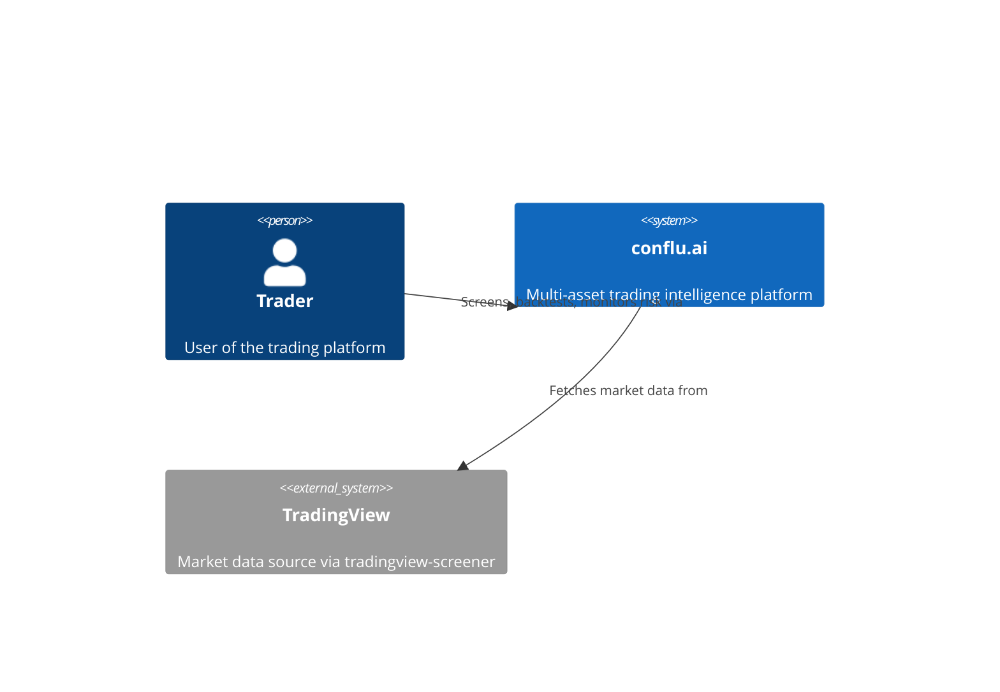
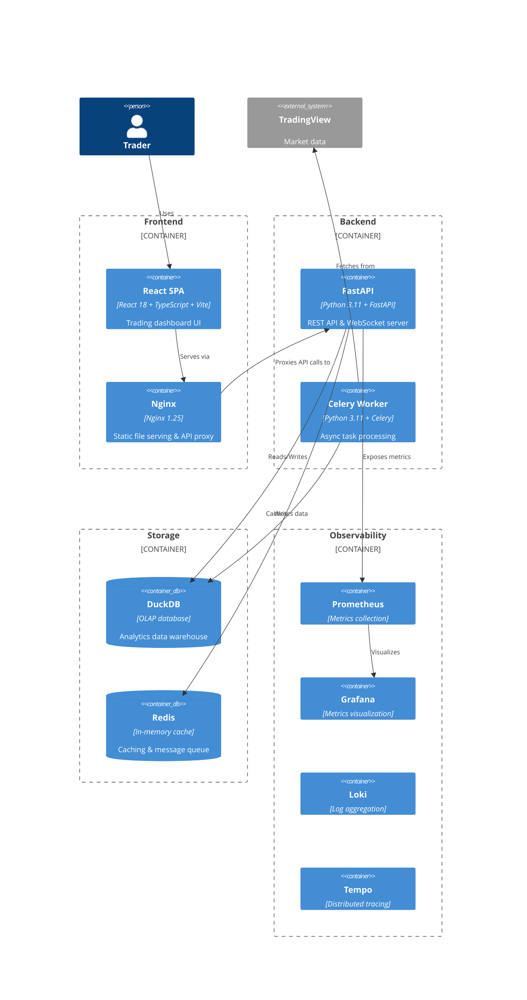
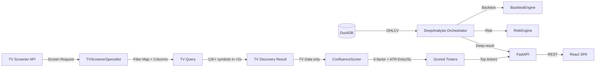

# ARCHITECTURE.md

> **Note:** This file is auto-generated from the MkDocs source at `docs/architecture.md`. Edit that file instead.

## Project: conflu.ai — Trading Intelligence Platform

A modular trading platform with DuckDB-based storage, TradingView data ingestion, and async analysis pipeline.

## Directory Structure

```
backend/
├── app/
│   ├── core/              # Shared infrastructure
│   │   ├── config.py      # Pydantic settings (6 classes + APISettings)
│   │   ├── database.py    # DuckDB connection + DDL + partition utils
│   │   └── logging.py     # structlog with correlation IDs
│   ├── domain/            # Domain models
│   │   └── models.py      # 8 frozen Pydantic models
│   ├── infrastructure/    # Technical implementations
│   │   ├── indicators.py  # @indicator decorator + 5 indicators
│   │   ├── ingest/        # Data ingestion pipeline
│   │   ├── backtest/      # Backtest engine (vectorbt-based)
│   │   └── risk/          # Risk management engine
│   └── api/               # FastAPI REST + WebSocket layer
│       ├── main.py        # create_app() factory — wires all middleware, routers, lifespan
│       ├── schemas.py     # ApiResponse/ApiErrorResponse envelopes + all request/response models
│       ├── exceptions.py  # ApiError hierarchy + register_exception_handlers()
│       ├── middleware.py  # TokenBucket, RequestLogMiddleware, RateLimitMiddleware, APIKeyMiddleware
│       ├── dependencies.py # Annotated DI aliases for ScreenEngine, BacktestEngine, RiskEngine, IndicatorCache
│       ├── observability.py # Prometheus metrics + OpenTelemetry tracing setup
│       ├── routers/       # REST endpoint modules
│       │   ├── __init__.py
│       │   ├── health.py  # GET /health, GET /health/ready
│       │   ├── screener.py # POST /api/v1/screen (JSON/CSV/JSON export)
│       │   ├── backtest.py # POST backtest/optimize/monte-carlo, GET results
│       │   ├── data.py    # GET indicators, OHLCV data, symbols
│       │   └── risk.py    # GET beta/correlation/var, POST kelly/position-size
│       └── ws/            # WebSocket streaming
│           ├── __init__.py
│           ├── manager.py # WebSocketManager singleton + channel subscription + background loops
│           ├── channels.py # PriceChannel & IndicatorChannel data providers
│           └── handler.py # /ws/stream endpoint with auth + reconnection
├── tests/
│   ├── conftest.py        # Shared fixtures
│   ├── test_config.py     # 11 tests
│   ├── test_database.py   # 7 tests
│   ├── test_models.py     # 12 tests
│   ├── test_indicators.py # 8 tests
│   ├── test_logging.py    # 6 tests
│   ├── test_ingest_scanner.py         # 7 tests
│   ├── test_ingest_symbol_map.py       # 11 tests
│   ├── test_ingest_quality.py         # 8 tests
│   ├── test_ingest_models.py          # 7 tests
│   ├── test_ingest_fetcher.py         # 6 tests
│   ├── test_ingest_writer.py          # 4 tests
│   ├── test_ingest_metrics.py         # 7 tests
│   ├── test_ingest_cli.py             # 11 tests
│   ├── test_risk_models.py            # 16 tests
│   ├── test_risk_beta.py              # 6 tests
│   ├── test_risk_correlation.py       # 5 tests
│   ├── test_risk_var.py               # 8 tests
│   ├── test_risk_kelly.py             # 7 tests
│   ├── test_risk_position_sizing.py   # 4 tests
│   ├── test_risk_streaming.py         # 7 tests
│   └── test_risk_engine.py            # 9 tests
│   ├── test_risk_models.py            # 16 tests
│   ├── test_risk_beta.py              # 6 tests
│   ├── test_risk_correlation.py       # 5 tests
│   ├── test_risk_var.py               # 8 tests
│   ├── test_risk_kelly.py             # 7 tests
│   ├── test_risk_position_sizing.py   # 4 tests
│   ├── test_risk_streaming.py         # 7 tests
│   └── test_risk_engine.py            # 9 tests
config.yaml              # Shared YAML configuration
Dockerfile               # Multi-stage Python build
docker-compose.yml       # 3 services: api, worker, redis
pyproject.toml           # Build config + deps + linting
```

## Data Flow — TV Screener Discovery (Primary)

```
User Screen Request (ScreenConfig YAML)
    ↓
TVScreenerSpecialist.build_query()
  → Compiles ScreenConfig to tradingview_screener.Query
  → Maps filters (price_above_ema, macd_bullish, etc.) to TV Column operations
  → Sets market (america), timeframe (1D), index (SYML:SP;SPX)
    ↓
TVScreenEngine.screen() / screen_multi_tf()
  → Single TF: one TV query → TVDiscoveryResult (tickers + raw TV data)
  → Multi-TF: one query per timeframe → intersect_tickers() strict AND
    ↓
TVConfluenceScorer.score()
  → 5-factor scoring from TV data only (no OHLCV)
  → Trend (30), Momentum (25), Volume (20), Quality (15), Fundamental (10)
  → ATR-based entry/SL/targets (2xATR stop, 2:1/3:1 R:R)
  → Rating: A+/A/B+/B/C/D
    ↓
API Response → TVScreenResponse (scored tickers with analysis)
```

## Data Flow — Deep Analysis (On-Demand)

```
User clicks "Analyze" on a ticker from TV results
    ↓
DeepAnalysisOrchestrator.analyze(symbol, timeframe)
  → Load OHLCV from DuckDB (ingestion pipeline)
  → Compute indicators via pandas-ta (compute_all)
  → Run backtest via BacktestEngine (vectorbt)
  → Run risk via RiskEngine (VaR, beta, Kelly, position sizing)
  → ATR-based entry/SL/targets (consistent with TV confluence)
    ↓
DeepAnalysisResult → API Response
```

## Data Flow — Ingestion Pipeline (for Backtest OHLCV)

```
TradingView Scanner
    ↓ scan_with_retry() [circuit breaker + exponential backoff]
IngestionFetcher.fetch_asset_class()
    ↓ (semaphore 50, batch size 100)
QualityReport ← validate_ohlcv()
    ↓
write_incremental() [DuckDB staging table dedup]
    ↓
Parquet partitions: {asset_class}/{year}/{month}/{symbol}_{timeframe}.parquet
    ↓
DuckDB ohlcv table (parquet-backed)
```

## Data Flow — API Layer

```
Client
    ↓
CORSMiddleware
    ↓
RequestLogMiddleware (correlation ID + timing)
    ↓
RateLimitMiddleware (token bucket per endpoint group)
    ↓
APIKeyMiddleware (X-API-Key header validation)
    ↓
Router Endpoints (REST) / WebSocket (ws/stream endpoint)
    ↓
ExceptionHandlers → {error: {code, message, details, request_id}}
```

## Key Design Decisions

- **TV Screener first**: All discovery goes through TradingView Screener, not local OHLCV — 12K+ symbols in <2s
- **Confluence scoring from TV data only**: No OHLCV needed for initial ranking — uses TV columns directly
- **DuckDB retained for backtest OHLCV**: Historical data still needed for deep analysis (backtest + risk)
- **Multi-TF via client-side intersection**: TV only supports single-TF queries, so multi-TF = multiple queries + intersect
- **ATR-based entry/SL/targets**: Available directly from TV — no local computation needed for screening
- Append-only Parquet with idempotent incremental updates
- TradingView free tier (no API key needed)
- Semaphore-based concurrency (no unbounded parallelism)
- Partial failures don't stop pipeline

---

## ⚠️ Known Automation Gaps (Not Yet Implemented)

The architecture includes config and docker-compose for automation, but the following are **NOT YET IMPLEMENTED**:

| Component | Status | Config Exists | Code Exists |
|-----------|--------|---------------|-------------|
| **Ingestion Scheduler** | ❌ Missing | `ingestion.daily_schedule_utc`, `ingestion.intraday_interval_s` | No APScheduler/Celery Beat |
| **Celery Worker** | ❌ Missing | docker-compose `worker` service | No `backend/app/worker/` module |
| **Celery Beat (Periodic Tasks)** | ❌ Missing | — | No beat schedule |
| **Auto-indicator cache refresh** | ❌ Missing | `compute.indicator_cache_enabled` | No periodic task |
| **Auto-screener streaming** | ❌ Missing | `screen.stream_interval_s` | Only on-demand via WebSocket |

**Current State:** Ingestion runs manually via CLI (`python -m backend.app.infrastructure.ingest.cli`). The `worker` service in docker-compose will fail to start because there's no Celery app/tasks module.

**To Enable Automation:**
1. Create `backend/app/worker/tasks.py` with Celery app
2. Add APScheduler or Celery Beat for periodic ingestion
3. Schedule `IndicatorCache.update_cache()` after ingestion completes
4. Add beat schedule for `daily_schedule_utc` and `intraday_interval_s`

See [Phase 2 Plan](.planning/phases/02-data-ingestion-pipeline/02-PLAN.md) and [Phase 10](.planning/phases/10-production-hardening/10-PLAN.md) for detailed implementation tasks.

## API Design Decisions

- **Response envelope**: `{data: T, meta: {timestamp, request_id}}` — consistent across all endpoints
- **Error envelope**: `{error: {code, message, details, request_id}}` — structured error responses
- **Middleware order**: CORSMiddleware → RequestLogMiddleware → RateLimitMiddleware → APIKeyMiddleware
- **Rate limiting**: In-process TokenBucket with per-endpoint groups (not Redis-backed)
- **WebSocket**: Single multiplexed endpoint `/ws/stream` with channel-based subscriptions (price:{symbol}, indicator:{symbol})
- **WebSocket pooling**: Single WebSocketManager singleton with background update loops (on-demand: only when clients subscribed)
- **WebSocket reconnection**: Per-connection sequence numbering + history buffer (100 msgs) for replay
- **Observability**: Prometheus metrics via `prometheus-fastapi-instrumentator` (auto-expose `/metrics`); OpenTelemetry optional (console exporter if no OTLP endpoint)
- **DI pattern**: `Annotated[Type, Depends()]` for engine dependencies — compliant with ruff B008 rules
- **Pydantic strictness**: All models use `frozen=True, extra="forbid"`

---

## System Context (C4 Level 1)



## Container Diagram (C4 Level 2)



## Data Flow



## Technology Stack

| Layer | Technology | Purpose |
|-------|-----------|---------|
| Frontend | React 18, TypeScript, Vite | UI framework & build |
| Charts | TradingView Lightweight Charts | Financial charts |
| Styling | Tailwind CSS | Utility-first CSS |
| State | Zustand + React Query | Client state & server cache |
| Backend | Python 3.11, FastAPI | REST API & WebSocket |
| Database | DuckDB | OLAP analytics (columnar) |
| Cache | Redis | In-memory cache & queue |
| Data Source | tradingview-screener | Market data |
| Metrics | Prometheus + Grafana | Observability |
| Logs | structlog + Loki | Structured logging |
| Tracing | OpenTelemetry + Tempo | Distributed tracing |
| Compute | vectorbt + pandas-ta | Vectorized indicators & backtesting |
| CI/CD | GitHub Actions | Automation |
