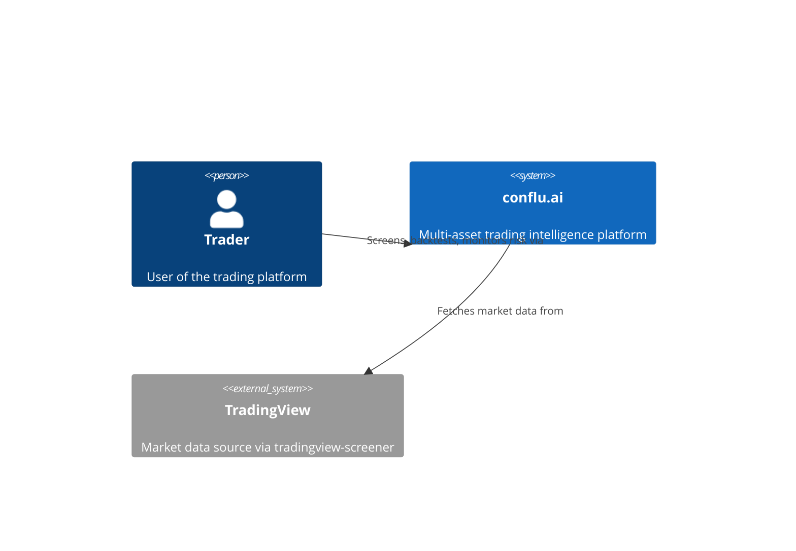
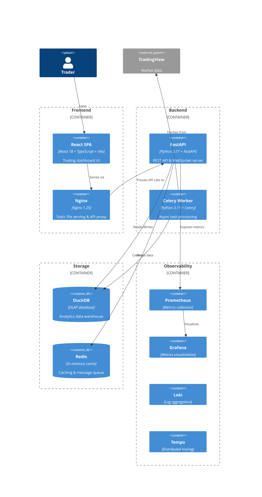
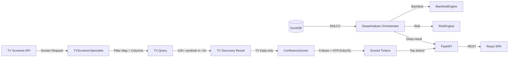

# ARCHITECTURE.md

> **Note:** This file is auto-generated from the MkDocs source at `docs/architecture.md`. Edit that file instead.

## Project: conflu.ai — Trading Intelligence Platform

A modular trading platform built **TradingView Screener-first**: live discovery, confluence scoring, and signals come from TradingView columns with **no OHLCV dependency**; charts, indicators, ticker analysis, and the Morning Brief fetch **live and on-demand** from TradingView / Yahoo Finance. DuckDB is an **optional, non-load-bearing** store for backtest/risk OHLCV only. This is NOT a traditional "ingest overnight + precompute indicators" system.

## Directory Structure

```
backend/
├── app/
│   ├── core/              # Shared infrastructure
│   │   ├── config.py      # Pydantic settings (6 classes + APISettings + ProfessionalSettings)
│   │   ├── database.py    # DuckDB connection + DDL + partition utils
│   │   └── logging.py     # structlog with correlation IDs
│   ├── domain/            # Domain models
│   │   └── models.py      # 8 frozen Pydantic models
│   ├── infrastructure/    # Technical implementations
│   │   ├── indicators.py  # @indicator decorator + 5 indicators
│   │   ├── ingest/        # Data ingestion pipeline
│   │   ├── backtest/      # Backtest engine (vectorbt-based)
│   │   ├── risk/          # Risk management engine
│   │   └── professional/  # Professional Mode workflow layer
│   │       ├── __init__.py
│   │       ├── models.py
│   │       ├── morning_brief.py
│   │       ├── regime_selector.py
│   │       ├── position_sizer.py
│   │       ├── education.py
│   │       └── alert_service.py
│   └── api/               # FastAPI REST + WebSocket layer
│       ├── main.py        # create_app() factory — wires all middleware, routers, lifespan
│       ├── schemas.py     # ApiResponse/ApiErrorResponse envelopes + all request/response models
│       ├── exceptions.py  # ApiError hierarchy + register_exception_handlers()
│       ├── middleware.py  # TokenBucket, RequestLogMiddleware, RateLimitMiddleware, APIKeyMiddleware
│       ├── dependencies.py # Annotated DI aliases for ScreenEngine, BacktestEngine, RiskEngine, IndicatorCache
│       ├── observability.py # Prometheus metrics + OpenTelemetry tracing setup
│       ├── routers/       # REST endpoint modules
│       │   ├── __init__.py
│       │   ├── health.py  # GET /health, GET /health/ready
│       │   ├── screener.py # POST /api/v1/screen (JSON/CSV/JSON export)
│       │   ├── backtest.py # POST backtest/optimize/monte-carlo, GET results
│       │   ├── data.py    # GET indicators, OHLCV data, symbols
│       │   ├── risk.py    # GET beta/correlation/var, POST kelly/position-size
│       │   └── professional.py # Professional Mode endpoints (7 endpoints)
│       └── ws/            # WebSocket streaming
│           ├── __init__.py
│           ├── manager.py # WebSocketManager singleton + channel subscription + background loops
│           ├── channels.py # PriceChannel & IndicatorChannel data providers
│           └── handler.py # /ws/stream endpoint with auth + reconnection
├── tests/
│   ├── conftest.py        # Shared fixtures
│   ├── test_config.py     # 11 tests
│   ├── test_database.py   # 7 tests
│   ├── test_models.py     # 12 tests
│   ├── test_indicators.py # 8 tests
│   ├── test_logging.py    # 6 tests
│   ├── test_ingest_scanner.py         # 7 tests
│   ├── test_ingest_symbol_map.py       # 11 tests
│   ├── test_ingest_quality.py         # 8 tests
│   ├── test_ingest_models.py          # 7 tests
│   ├── test_ingest_fetcher.py         # 6 tests
│   ├── test_ingest_writer.py          # 4 tests
│   ├── test_ingest_metrics.py         # 7 tests
│   ├── test_ingest_cli.py             # 11 tests
│   ├── test_risk_models.py            # 16 tests
│   ├── test_risk_beta.py              # 6 tests
│   ├── test_risk_correlation.py       # 5 tests
│   ├── test_risk_var.py               # 8 tests
│   ├── test_risk_kelly.py             # 7 tests
│   ├── test_risk_position_sizing.py   # 4 tests
│   ├── test_risk_streaming.py         # 7 tests
│   └── test_risk_engine.py            # 9 tests
config.yaml              # Shared YAML configuration
Dockerfile               # Multi-stage Python build
docker-compose.yml       # 3 services: api, worker, redis
pyproject.toml           # Build config + deps + linting
```

## Data Flow — TV Screener Discovery (Primary)

```
User Screen Request (ScreenConfig YAML)
    ↓
TVScreenerSpecialist.build_query()
  → Compiles ScreenConfig to tradingview_screener.Query
  → Maps 56 filters (price_above_ema, macd_bullish, trend_stack, etc.) to TV Column operations
  → Uses _and()/_or() for composable multi-filter logic
  → Sets market (america), timeframe (1D), index (SYML:SP;SPX)
    ↓
TVScreenEngine.screen() / screen_multi_tf()
  → Single TF: one TV query → TVDiscoveryResult (tickers + raw TV data)
  → Multi-TF: one query per timeframe → intersect_tickers() strict AND
    ↓
TVConfluenceScorer.score()
  → 5-factor scoring from TV data only (no OHLCV)
  → Trend (30), Momentum (25), Volume (20), Quality (15), Fundamental (10)
  → Adaptive regime-aware weights: strong_trend / ranging / high_vol / low_vol
  → RS rating >60 → +5 Quality bonus
  → ATR-based entry/SL/targets (2xATR stop, 2:1/3:1 R:R)
  → Rating: A+/A/B+/B/C/D
    ↓
EliteSignalProcessor.enrich()
  → RS Rating (1-99 percentile across screen cohort)
  → Institutional Quality (0-100): market cap, volume, analyst, dividend
  → Signal Conviction (high/medium/low): RS + quality + factor conflict check
  → Wyckoff Phase Proxy: accumulation/markup/distribution/markdown
  → Factor conflict flags: trend/momentum/volume divergence detection
  → Regime tag passthrough
    ↓
API Response → TVScreenResponse (scored tickers with elite enrichment)
```

## Data Flow — Deep Analysis (On-Demand)

```
User clicks "Analyze" on a ticker from TV results
    ↓
DeepAnalysisOrchestrator.analyze(symbol, timeframe)
  → Load OHLCV from DuckDB (ingestion pipeline)
  → Compute indicators via pandas-ta (compute_all)
  → Run backtest via BacktestEngine (vectorbt)
  → Run risk via RiskEngine (VaR, beta, Kelly, position sizing)
  → ATR-based entry/SL/targets (consistent with TV confluence)
    ↓
DeepAnalysisResult → API Response
```

## Data Flow — Ingestion Pipeline (for Backtest OHLCV)

```
TradingView Scanner
    ↓ scan_with_retry() [circuit breaker + exponential backoff]
IngestionFetcher.fetch_asset_class()
    ↓ (semaphore 50, batch size 100)
QualityReport ← validate_ohlcv()
    ↓
write_incremental() [DuckDB staging table dedup]
    ↓
Parquet partitions: {asset_class}/{year}/{month}/{symbol}_{timeframe}.parquet
    ↓
DuckDB ohlcv table (parquet-backed)
```

## Data Flow — API Layer

```
Client
    ↓
CORSMiddleware
    ↓
RequestLogMiddleware (correlation ID + timing)
    ↓
RateLimitMiddleware (token bucket per endpoint group)
    ↓
APIKeyMiddleware (X-API-Key header validation)
    ↓
Router Endpoints (REST) / WebSocket (ws/stream endpoint)
    ↓
ExceptionHandlers → {error: {code, message, details, request_id}}
```

## Data Flow — Ticker Analysis (Elite Trader Grade)

```
User clicks "Analyze" on a ticker
    ↓
TickerAnalysisService.analyze()
  → Fetch TV screener data (current snapshot)
  → Fetch yfinance info (fundamentals, earnings, sentiment)
  → Fetch yfinance OHLCV (6mo daily for swing detection)
  → Fetch yfinance OHLCV (2y weekly for weekly structure)
  → Fetch yfinance OHLCV (3mo 4h / 1mo 1h for intraday structure) [optional]
    ↓
Technical Module (per timeframe)
  → Detect swings (5-bar fractals) → Classify structure (HH/HL vs LH/LL)
  → Cluster swings → Key support/resistance levels
  → Score pullback quality (A+ to F): depth, volume dry-up, structure hold
  → Compute TPO volume profile (POC, VAH, VAL, HVN, LVN)
  → Standard indicators: MA stack, RSI, ADX, MACD, BB, ATR
    ↓
Fundamental/Earnings/Sentiment/Risk Modules
    ↓
Synthesis Engine
  → Regime-adaptive weights (strong_trend/ranging/high_vol/low_vol)
  → Catalyst bias overlay (earnings proximity, analyst targets, insider/short)
  → Dynamic R:R (trend quality, vol regime, fundamental quality)
  → Scale-in plan (3 tranches), Scale-out (1R/0.7R/full target), Trail (ATR/structure), Breakeven at 1R
  → Time stop (counter-trend 20d, dev-stage 60d), Risk caps (position/daily loss)
  → Catalyst notes in thesis
    ↓
Macro Overlay (VIX, breadth, risk appetite, safe haven, yield curve)
    ↓
Verdict → Trade Plan + Verdict + Catalyst Notes
```

## Data Flow — Enhanced Options Flow

```
GET /ticker/{symbol}/options-flow
    ↓
Fetch full options chain (calls/puts all strikes)
    ↓
Compute per-strike metrics:
  → GEX by strike (gamma × OI × 100 × spot × 0.01)
  → Total GEX, Net GEX, Dealer Position (long/short gamma)
  → GEX Flip Level (strike > spot where GEX > 0)
  → Max Pain (OI-weighted pain minimization)
  → Put/Call Ratio (OI-based)
  → Unusual Activity (vol > 2×OI & OI>100)
  → High OI strikes (top 5 calls/puts)
  → Term Structure (IV mean across 6 expiries)
  → Max Pain distance from spot (%)
    ↓
Return: Spot, IV Rank/Mean, Max Pain, GEX (total/by-strike/flip), PCR, Unusual Activity, Key Levels, Term Structure
```

## Data Flow — Catalyst Bias Analysis

```
Earnings Proximity (from yfinance earningsTimestampStart)
  → Days to earnings → Bias: cautious (0-5d), positive/negative drift (6-21d)
  → Last surprise pct → Momentum bias
  
Analyst Target vs Current Price
  → Target upside > 20% → bullish
  → Target upside < -10% → bearish

Insider Ownership
  → >20% → alignment bullish
  → <1% → minimal alignment bearish

Short Interest % of Float
  → >30% → squeeze risk / bearish
  → 15-30% → elevated bearish

Dividend Ex-Date Proximity (0-10 days) → Event catalyst
  
Aggregate Score → Bias: bullish/bearish signals → Final Bias (positive/slightly_positive/neutral/slightly_negative/negative)
```

## Key Design Decisions

- **TV Screener first**: All discovery goes through TradingView Screener, not local OHLCV — 12K+ symbols in <2s
- **Live everywhere; no overnight batch**: Charts, indicators (`GET /data/indicators/{symbol}`), ticker analysis, regime detection, sector rotation, and Morning Brief all fetch **live on-demand** from TradingView / Yahoo Finance. Indicators are computed on-the-fly with pandas-ta — **no precomputed indicator warehouse**.
- **Confluence scoring from TV data only**: No OHLCV needed for initial ranking — uses TV columns directly
- **DuckDB is optional, non-load-bearing**: Historical OHLCV in DuckDB (ADR-001) is used ONLY by on-demand backtest/risk. It is never on the discovery/screening/analysis path. If DuckDB data is missing or stale, all core features still work. The `indicator_values` table / IndicatorCache is **retired** (D-23).
- **Multi-TF via client-side intersection**: TV only supports single-TF queries, so multi-TF = multiple queries + intersect
- **ATR-based entry/SL/targets**: Available directly from TV — no local computation needed for screening
- **26 TV filters** across trend, momentum, volume, volatility, pattern, and fundamental categories
- **21 total screen templates** available (Low-Vol Setup, Mean Reversion, Oversold Bounce, Statistical Mean Reversion, Momentum Breakout, Breakout, Quality Trend + Fundamentals, Volume-Confirmed Uptrend, Bull Flag Continuation, 52-Week Breakout, Trend Follower, Trend Follower MTF, High-Conviction Stack, Volatility Expansion, Institutional Swing Quality, Institutional Trend Follower MTF, Volume-Confirmed Uptrend, Volume Surge, Volume Surge Breakout, Volume+Trend Accumulation, Trend Leader)
- **4 adaptive regime weight tables**: strong_trend, ranging, high_vol, low_vol — each with different factor emphasis
- **Post-TV signal enrichment**: EliteSignalProcessor adds RS rating, institutional quality, signal conviction, Wyckoff phase proxy
- **RS rating is relative percentile** within the current screen cohort, not an absolute score
- **Signal conviction** = RS rating + institutional quality + factor conflict absence
- **Wyckoff phase is a heuristic proxy** based on price + volume trend combination
- **Market structure from yfinance OHLCV**: Swing detection (5-bar fractal), structure classification, key levels, pullback quality, TPO volume profile
- **Volume Profile (TPO) from daily bars**: POC, VAH/VAL (70% value area), HVN/LVN — approximates institutional order flow
- **Dynamic Trade Plan per verdict**: Scale-in (3 tranches), scale-out (1R/0.7R/target), trail (ATR/structure), breakeven at 1R, time stops, risk caps
- **Enhanced Options Flow**: GEX by strike, flip level, max pain, dealer positioning, unusual volume, term structure
- **Catalyst Bias**: Earnings proximity/drift, analyst targets, insider/short interest → bias score (-10 to +10) → applied to synthesis
- **Multi-timeframe via yfinance**: Daily (6mo), Weekly (2y), 4H (1mo), 1H (1mo) — all from yfinance
- **Volume Profile (TPO)**: TPO-style from daily bars — POC, VAH/VAL, HVN/LVN — no tick data needed
- **Volume Profile (TPO)**: TPO-style from daily bars — POC, VAH/VAL, HVN/LVN — no tick data needed
- **Macro Regime Overlay**: VIX, sector breadth, risk appetite, safe haven, yield curve → adjusts stops/position sizing/quality bias
- **Append-only Parquet with idempotent incremental updates**
- **TradingView free tier (no API key needed)**
- **Semaphore-based concurrency (no unbounded parallelism)**
- **Partial failures don't stop pipeline**

---

---

## ⚠️ Known Automation Gaps (Intentionally Deferred)

The architecture includes config and docker-compose for optional automation, but the following are **not actively implemented**:

| Component | Status | Notes |
|-----------|--------|-------|
| **Ingestion Scheduler** | ❌ Manual CLI | Ingestion runs via `python -m backend.app.infrastructure.ingest.cli`. No APScheduler/Celery Beat. |
| **Celery Worker/Beat** | 🔌 Profile-only | Docker compose `worker`/`beat` services exist in `profiles: ["workers"]`. Never started by default. |
| **Auto-indicator cache refresh** | ❌ **Retired (D-23)** | Indicators are computed on-demand from live data. No precomputed indicator warehouse. |
| **Auto-screener streaming** | ❌ On-demand only | WebSocket streaming for price/signal updates only (not screener results). |

## API Design Decisions

- **Response envelope**: `{data: T, meta: {timestamp, request_id}}` — consistent across all endpoints
- **Error envelope**: `{error: {code, message, details, request_id}}` — structured error responses
- **Middleware order**: CORSMiddleware → RequestLogMiddleware → RateLimitMiddleware → APIKeyMiddleware
- **Rate limiting**: In-process TokenBucket with per-endpoint groups (not Redis-backed)
- **WebSocket**: Single multiplexed endpoint `/ws/stream` with channel-based subscriptions (price:{symbol}, indicator:{symbol})
- **WebSocket pooling**: Single WebSocketManager singleton with background update loops (on-demand: only when clients subscribed)
- **WebSocket reconnection**: Per-connection sequence numbering + history buffer (100 msgs) for replay
- **Observability**: Prometheus metrics via `prometheus-fastapi-instrumentator` (auto-expose `/metrics`); OpenTelemetry optional (console exporter if no OTLP endpoint)
- **DI pattern**: `Annotated[Type, Depends()]` for engine dependencies — compliant with ruff B008 rules
- **Pydantic strictness**: All models use `frozen=True, extra="forbid"`

---

## System Context (C4 Level 1)



## Container Diagram (C4 Level 2)



## Data Flow



## Technology Stack

| Layer | Technology | Purpose |
|-------|-----------|---------|
| Frontend | React 18, TypeScript, Vite | UI framework & build |
| Charts | TradingView Lightweight Charts | Financial charts |
| Styling | Tailwind CSS | Utility-first CSS |
| State | Zustand + React Query | Client state & server cache |
| Backend | Python 3.11, FastAPI | REST API & WebSocket |
| Database | DuckDB | OLAP analytics (columnar) |
| Cache | Redis | In-memory cache & queue |
| Data Source | tradingview-screener | Market data |
| Metrics | Prometheus + Grafana | Observability |
| Logs | structlog + Loki | Structured logging |
| Tracing | OpenTelemetry + Tempo | Distributed tracing |
| Compute | vectorbt + pandas-ta | Vectorized indicators & backtesting |
| CI/CD | GitHub Actions | Automation |

## Key Design Decisions

- **Professional Mode = Workflow Layer** — New entry point on top of existing engine
- **Hybrid Data Freshness** — 4 PM close for screening + pre-market quotes for display
- **Education as Infrastructure** — Static templates + optional LLM, not a separate product
