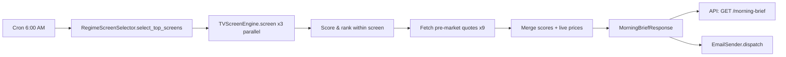

# ADR-010: Professional Mode Architecture

**Status:** Accepted
**Date:** 2026-07-26
**Phase:** 8

---

## Context

conflu.ai has 80% of the analytical engine built:
- TV Screener: 56 filters, 21 templates, adaptive confluence scoring
- Elite Signal Processor: RS Rating, Institutional Quality, Signal Conviction, Wyckoff Phase
- Deep Analysis: 8-tab ticker analysis (Technical, Fundamental, Earnings, Sentiment, Risk, Options, News, Chart)
- Backtest Engine: vectorbt-based with Monte Carlo, regime detection, optimization
- Risk Engine: VaR, Beta, Correlation, Kelly, Position Sizing
- Sector Rotation: 11 sectors with RS, momentum, flow signals
- Market Regime: VIX, risk appetite, breadth, safe haven, yield curve

**The gap:** No workflow layer for a working professional with zero market knowledge to:
1. Know what to do in 5 minutes each morning
2. Learn concepts in context (not courses)
3. Execute a disciplined swing workflow without staring at charts
4. Graduate to independent analysis over 6-12 months

---

## Decision

**Professional Mode is a workflow layer — NOT a replacement.** It sits on top of existing pages:

```
Dashboard → Morning Brief (/pro) → One-Click Verdict (/pro/ticker/{symbol})
                                             → Watchlist Builder (/pro/watchlist)
                                             → Settings (/pro/settings)
                                                  ↓
                               Links to existing: Screener, Deep Analysis, Portfolio, Charts
```

**No feature duplication.** Professional Mode links to existing pages for depth.

---

## Key Design Decisions

### D1: Workflow Layer, Not Replacement
- Professional Mode = new entry point + simplified views
- Existing Screener, Ticker Analysis, Portfolio, Charts unchanged
- "Analyze" button on ticker card → `/pro/ticker/{symbol}` (simplified)
- "Deep Analysis" link → existing `/ticker/{symbol}` (full 8 tabs)
- **Rationale:** Preserves power-user workflow; guides beginners without removing capability

### D2: Inline + Progressive Education
- Every metric: `?` tooltip with static template explanation
- "Explain more" button → LLM-enhanced (cached 24h, ~$0.50/day)
- Static templates for 20 core metrics (P/E, RSI, ATR%, Beta, ADX, MACD, Volume Ratio, etc.)
- Broader concepts (sector rotation, risk-on/off, conviction, regime) via `ConceptExplainer`
- **Rationale:** Working professionals learn in context, not via courses. Zero API cost for base templates.

### D3: Dual-Channel Alerts (Email + In-App)
| Alert Type | Email | In-App Push | Browser |
|------------|-------|-------------|---------|
| Morning Brief | ✅ 6 AM | ✅ Banner | — |
| Stop Hit | ✅ | ✅ | ✅ |
| Target Hit | — | ✅ | — |
| Earnings Tomorrow | ✅ 6 PM | — | — |
| Regime Change | ✅ | ✅ | — |
| Weekly Review | ✅ Sun 7 PM | — | Opt-in |

- Backend: `AlertService` with APScheduler cron jobs
- Email: SendGrid (free tier: 100/day) with logging fallback
- In-app: WebSocket + `NotificationBell` component
- **Rationale:** Professionals check email mornings/evenings; need real-time stop alerts during market hours.

### D4: Time-Gated Graduation with Manual Override
- Default: Professional Mode ON
- Features unlock on schedule (Day 1, 14, 30, 60, 90)
- `localStorage`: `proModeEnabled`, `proStartDate`, `featuresUnlocked[]`
- User can disable anytime in Settings
- **Rationale:** Prevents overwhelm; respects autonomy; no complex action tracking needed

### D5: Data Freshness — Hybrid (Close + Pre-Market)
- 5:30 AM: `RegimeScreenSelector` picks top 3 screens (cached 24h)
- 6:00 AM: `MorningBriefService` runs 3 screens on 4 PM close data (parallel, ~2s)
- 6:00 AM: Fetch pre-market quotes for 9 tickers (parallel, ~0.5s)
- 6:00 AM: Merge + format → API ready + email dispatch
- **Fallback:** If pre-market fails → show 4 PM close prices with "Pre-market unavailable" badge
- **Scheduler:** APScheduler cron job at 6:00 AM ET. Runs in `api` container (existing). No new infrastructure.

---

## Architecture

### New Backend Services (`backend/app/infrastructure/professional/`)

| Service | Responsibility | Dependencies |
|---------|----------------|--------------|
| `MorningBriefService` | Select screens → run → rank → format + pre-market quotes | `TVScreenEngine`, `RegimeScreenSelector`, `SectorRotationService`, `MarketRegimeService` |
| `RegimeScreenSelector` | Heuristic scoring of 21 screens vs. current regime | Screen YAML configs, `tv_cache` |
| `PositionSizer` | Kelly + conviction tiers + hard caps (5% pos, 15% sector) | `RiskEngine.position_size()` |
| `EducationService` | 20 static templates + LLM enhancement stub | — |
| `AlertService` | Scheduled (cron) + real-time alerts; email + in-app | `APScheduler`, `EmailSender`, `WebSocketManager` |

### New API Endpoints (`/api/v1/professional/`)

| Endpoint | Method | Description |
|----------|--------|-------------|
| `/morning-brief` | GET | Full morning brief JSON |
| `/verdict/{symbol}` | GET | Simplified verdict (action, conviction, entry/stop/targets, position size, education) |
| `/watchlist/analyze` | POST | Batch analyze watchlist symbols |
| `/education/{metric}` | GET | Metric explanation (template or LLM) |
| `/position-size` | GET | Calculate position size from params |
| `/alerts/preferences` | GET/PUT | Alert preferences |
| `/alerts` | GET | Recent in-app alerts |

### New Frontend Pages (`frontend/src/components/professional/`)

| Page | Route | Key Components |
|------|-------|----------------|
| Morning Brief | `/pro` | `MorningBriefPage`, `MarketInternalsStrip`, `SectorHeatmapMini`, `TickerCard` |
| One-Click Verdict | `/pro/ticker/:symbol` | `SimpleVerdictPage`, `EducationTooltip`, position sizing |
| Watchlist Builder | `/pro/watchlist` | `WatchlistBuilderPage`, batch analyze, paper trade |
| Settings | `/pro/settings` | `ProSettingsPage`, `GraduationProgress`, alert prefs |

### Shared Frontend Infrastructure

| File | Purpose |
|------|---------|
| `store/professional.ts` | Zustand store: enabled, startDate, accountSize, riskTolerance, notifications, unlockedFeatures |
| `hooks/useProMode.ts` | Derived: `daysActive`, `isFeatureUnlocked(feature)` |
| `hooks/useEducation.ts` | Static lesson lookup + LLM enhancement fetch + 24h localStorage cache |
| `hooks/useNotifications.ts` | In-app notification queue + WebSocket listener |
| `components/professional/EducationTooltip.tsx` | Hover tooltip + "Explain more" button |
| `components/professional/ConceptExplainer.tsx` | Broader trading concepts (sector rotation, regime, etc.) |
| `components/professional/NotificationBell.tsx` | Header bell + dropdown |
| `components/professional/ConceptExplorer.tsx` | Full reference browser (metrics/modules/glossary tabs) |

---

## Data Flows

### Morning Brief Generation (6 AM ET)



### One-Click Verdict

```mermaid
flowchart LR
    A[GET /verdict/{symbol}] --> B[TickerAnalysisService.analyze]
    B --> C[Extract simplified verdict]
    C --> D[PositionSizer.calculate]
    D --> E[EducationService.explain x8]
    E --> F[SimplifiedVerdictResponse]
```

---

## Consequences

### Benefits
- **Zero learning curve:** Guided workflow from Day 1
- **Preserves power users:** Existing pages unchanged
- **Education built-in:** Tooltips on every metric, progressive LLM enhancement
- **Risk-first:** Position sizing with hard caps default
- **Graduation path:** 90-day unlock prevents overwhelm
- **Low infrastructure:** No new databases, uses existing APScheduler/Redis/WS

### Risks & Mitigations
| Risk | Mitigation |
|------|------------|
| Morning brief fails at 6 AM | Graceful degradation: show cached/close data; alert dev via log |
| LLM education costs spike | Hard cap 500 calls/day; static templates always work |
| Email delivery fails | Log email content; in-app banner shows brief; retry next cycle |
| Pre-market quotes unavailable | Show 4 PM close with badge; verdict logic uses close prices |
| Users confused by two modes | Clear header toggle; "Guided/Explorer" labels; Settings explains both |

### Technical Debt
- `AlertService` in-memory preferences (no DB) — Phase 6+ auth will persist
- `EducationService` LLM stub not yet wired — feature flag `llm_education_enabled`
- Graduation uses `localStorage` only — Phase 6+ will sync to backend

---

## References
- CONTEXT.md decisions A-G
- Plan 8A: Backend Services
- Plan 8B: Frontend Pages
- Plan 8C: Education Content
- Plan 8D: Integration & Testing
- ADR-004: TradingView Screener for Data (engine foundation)
- ADR-011: Ticker Analysis Elite Trader Upgrade (deep analysis foundation)